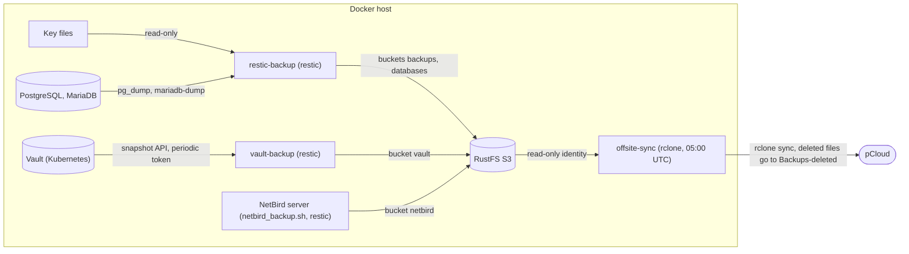

# GitOps

Infrastructure as code for the two servers (a Docker host and a k3s node).

| Folder | Content |
|---|---|
| `ansible/` | Host setup with Ansible: base system, firewall (UFW), Docker, NetBird, k3s and its registry mirror, database servers, node exporter, postgres exporter, mysqld exporter, the deploy timer of the Docker host. Secrets in an ansible-vault file. |
| `docker/` | One Docker Compose project per service on the Docker host (restic-backup, RustFS, offsite sync, ...), deployed by `scripts/docker/deploy.sh`, on the Docker host hourly from 08:00 to 20:00 by a systemd timer. Images are pinned by digest and updated by Renovate. |
| `istio/` | `IstioOperator` file for the manual `istioctl install` (outside ArgoCD). |
| `tofu/` | OpenTofu: VMs on the Proxmox host (`tofu/proxmox/`), state in PostgreSQL. Cloud-init installs Ansible and checks out this repository on each VM. |
| `kubernetes/` | ArgoCD app-of-apps, one folder per domain (infra, monitoring, cicd, management, kafka, spring). |
| `scripts/` | Helper scripts: Ansible secrets, backup host setup, Vault (PowerShell), database administration, Linux benchmarks. |

## Contents

- [Ansible](#ansible)
- [OpenTofu (Proxmox VMs)](#opentofu-proxmox-vms)
- [Updates (Renovate)](#updates-renovate)
- [Docker](#docker)
- [Kubernetes](#kubernetes)

## Ansible

Run everything in this section from the `ansible/` folder.

### Install Ansible

Install Ansible and Git on Debian:

```bash
sudo apt update
sudo apt install -y ansible git && git clone https://github.com/ToXiCCuss/gitops.git
```

Then switch to the repository and install the required collections:

```bash
cd gitops/ansible
ansible-galaxy collection install -r requirements.yml
```

### Dry Run

Before the actual execution, check the playbook in check mode. This does not make any changes:

```bash
ansible-playbook -i inventory.ini site.yml --check --diff
```

### Apply Changes

If the dry run completes without unexpected errors, run the playbook:

```bash
ansible-playbook -i inventory.ini site.yml
```

### Firewall

The role `firewall` runs on the hosts in `firewall_hosts` (`group_vars/all/main.yml`). It allows the ports listed in `host_config.<host>.firewall_rules`, denies all other incoming traffic and enables UFW. Each rule needs a `comment`; `port` and `proto` are optional (without them the rule opens every port for `from_ip`), `from_ip` is optional (default: any):

```yaml
host_config:
  docker01:
    firewall_rules:
      - { port: 9000, proto: tcp, from_ip: 172.16.0.0/12, comment: "RustFS S3 from the Docker networks" }
```

- UFW only filters traffic to host processes (sshd, PostgreSQL, node_exporter, the NetBird client). Ports published by Docker bypass it (FORWARD chain), a rule here neither opens nor closes them.
- There is no UFW rule for SSH: `docker01` is reached through NetBird and port 22 is closed to the Internet.
- The role never removes rules. A rule that is no longer wanted is removed by hand once (`ufw delete ...`) after it is deleted from `firewall_rules`.
- Run only this role with `--tags firewall`. Do a dry run (`ansible-playbook -i inventory.ini site.yml --tags firewall --check --diff`) before the first real run and compare it with `ufw status verbose` on the host. Adding a comment to an existing rule counts as a change once.

### k3s

The role `k3s` runs on the hosts in `k3s_hosts` (`group_vars/all/main.yml`). It installs the pinned `k3s_version` with the official install script, writes `/etc/rancher/k3s/config.yaml` and keeps the service running. The server flags are the keys of `host_config.<host>.k3s_config` (`node-ip` defaults to the primary IPv4 address), the registry mirror stays in the role `k3s_registries`.

- Change a flag: edit `k3s_config`, run `ansible-playbook -i inventory.ini site.yml --tags k3s`. k3s is restarted once (the API server is gone for a moment, the pods keep running).
- Upgrade: change `k3s_version` (a release from https://github.com/k3s-io/k3s/releases) and run the same command. Do a dry run (`--tags k3s --check --diff`) first.
- A node that was installed with the flags in the systemd unit is migrated by the first run: the install script rewrites the unit without flags, they move to `config.yaml`, and k3s restarts once.
- The cluster uses embedded etcd (`cluster-init`). Its snapshots are only local (`/var/lib/rancher/k3s/server/db/snapshots`), they are not part of the backups yet.
- The role also writes the kernel parameters the kubelet expects (`/etc/sysctl.d/90-kubelet.conf`, variable `k3s_kernel_sysctls`). Without `protect-kernel-defaults` the kubelet would set them itself, the file makes them persistent.
- `k8sdev01` has a UFW rule for the pod CIDR `10.42.0.0/16` and the service CIDR `10.43.0.0/16`, so pods can reach the host (for example the API server through the service address). Everything else stays closed, the node is reached through NetBird.
- Istio is installed by hand after k3s with `istioctl` and `istio/istio-operator.yaml` (see [Istio installation](#istio-installation-istioctl-by-hand)).

### Node exporter and update monitoring

Every host in `node_exporter_hosts` (`docker01` and `k8sdev01`) runs the Debian package `prometheus-node-exporter` with the textfile collector (`/var/lib/prometheus/node-exporter`). The Prometheus stack has no node-exporter pod: it would use the same port 9100, and the textfile metrics (backups, deploy, updates) only exist on the host. Prometheus scrapes both hosts in the job `node-exporter` (`kubernetes/monitoring/helm/prometheus.yaml`). The exporter leaves out the mounts of the kubelet and k3s (`node_exporter_mount_points_exclude`).

The timer `node-update-status.timer` (hourly) runs `/usr/local/bin/node-update-status.sh`, which writes `node-update-status.prom`:

| Metric | Meaning |
|---|---|
| `node_reboot_required_since_timestamp_seconds` | Since when a reboot is needed, `0` if none is: `/var/run/reboot-required`, or (Debian does not create that file) the arrival of a kernel image that is newer than the running kernel |
| `node_pending_updates{type="all\|security"}` | Packages that `apt-get --simulate dist-upgrade` would install or upgrade |
| `node_unattended_upgrades_last_run_timestamp_seconds` | The last run of unattended-upgrades |

`unattended-upgrades` installs the security updates by itself and never reboots (`unattended_upgrades_reboot: false`), because a reboot of `k8sdev01` stops all Applications for a moment. The alerts in `kubernetes/monitoring/kubectl/alert-rules-os-updates.yaml` go to Discord: `RebootRequired` (more than 7 days), `UnattendedUpgradesStalled` (no run for 3 days) and `SecurityUpdatesPending` (3 days). Reboot `k8sdev01` yourself in a quiet moment (`sudo reboot`, the pods start again by themselves).

Rollout on `k8sdev01` (it had the node-exporter pod before):

1. Merge to `master`. Argo CD removes the pod (the port is free) and Prometheus has a new target `89.144.46.204:9100`, which is down until step 2. `TargetDown` waits 5 minutes, so do step 2 right away.
2. On `k8sdev01`: `git pull` in `/root/gitops/ansible`, then `ansible-playbook -i inventory.ini site.yml --tags node_exporter --check --diff` and without `--check`. The same run changes `docker01` (new mount filter, update timer).
3. Check: `systemctl status prometheus-node-exporter node-update-status.timer`, `curl -s localhost:9100/metrics | grep -E "node_pending_updates|node_reboot"` and the target in Prometheus. The old `instance` labels (node name, pod address) of `k8sdev01` end, the dashboards pick the new series up through the job `node-exporter`.

### Database tuning

The roles `postgresql`, `mariadb` and `mongodb` include the role `database_tuning` at their end. It sets, per database:

- sysctls in `/etc/sysctl.d/70-<database>.conf` (`vm.swappiness=1`, `vm.dirty_*`, `net.core.somaxconn`, `net.ipv4.tcp_keepalive_time`, `fs.aio-max-nr`; MongoDB also `vm.max_map_count`),
- a systemd drop-in `limits.conf` with `LimitNOFILE` and `OOMScoreAdjust=-900` (the OOM killer takes containers first),
- the transparent huge pages mode via `/etc/tmpfiles.d/transparent-hugepage.conf`: `madvise` for PostgreSQL and MariaDB, for MongoDB `never` (7.0 and older) or `always` (8.0). THP is host-wide, so databases with different modes on one host overwrite each other.

`/etc/security/limits.conf` is not used: systemd services ignore it. The service restarts once when the drop-in changes. Values are in the role's `defaults/main.yml`; MariaDB runs on `docker01`, MongoDB is not assigned to a host yet.

### MariaDB (audit log and backup user)

The role `mariadb` sets `bind-address` and `event_scheduler = ON` (`/etc/mysql/mariadb.conf.d/60-gitops.cnf`). The scripts in `scripts/mariadb/` (run them on the host with `sudo`) add an audit log and the backup user. MariaDB runs on `docker01` (`mariadb_hosts`), port 3306 is open for the Docker networks `172.16.0.0/12` only (`firewall_rules`, like PostgreSQL).

| Script | Purpose |
|---|---|
| `audit_setup.sh [--dry-run] <db> [months]` | Creates `audit_log` (partitioned by month) and the helper procedures in the database, and a daily event that adds the next months and drops the partitions older than the retention (default 6 months). Run it again to change the retention (`audit_setup.sh shop 12`); without months the current value stays. The data of `audit_log` is kept. |
| `audit_enable.sh [--dry-run] <db> <table> ...` | Triggers write the old and new values of every INSERT, UPDATE and DELETE of the tables to `audit_log`. Run it again after a column changed. The record id is the primary key (several columns joined by `-`), `NULL` without one. An UPDATE that changes nothing is not logged. |
| `audit_disable.sh [--dry-run] <db> <table> ...` | Removes the triggers (a table without them is `unchanged`). Rows already logged stay until the retention drops them. |
| `audit_list.sh <db>` | Audited tables, retention, partitions with their row counts. |
| `backup_user_create.sh [user] [reset]` | Read-only login for the backup (`restic-backup`, default `backup`, host `%`, so keep port 3306 closed except for the Docker networks): `SELECT`, `SHOW VIEW`, `TRIGGER`, `EVENT`, `LOCK TABLES` on all databases. The password goes to Vault (`databases/mariadb/backup`) and is not printed, `reset` sets a new one. |

- The audit log lives in the database, so `db_delete.sh` takes it along. It holds personal data in clear text. The roles of `db_create.sh` can change it, their grants cover the whole database.
- An audited write costs one more INSERT with all columns as JSON, so switch it on only for the tables where you need the history. A database without `audit_setup.sh` has no triggers and no cost.
- The partition `p_future` (`VALUES LESS THAN MAXVALUE`) catches every row without a monthly partition. A stopped event scheduler only leaves the partitions unmaintained, audited writes never fail.
- Monitoring: the role `mariadb_exporter` installs `prometheus-mysqld-exporter` (port 9104, scraped by the job `mysqld-exporter` in `kubernetes/monitoring/helm/prometheus.yaml`, alert `MariaDBDown` on `mysql_up`). It logs in as the MariaDB user `prometheus@localhost` through the socket (`unix_socket`, no password, `MAX_USER_CONNECTIONS 3`) with `PROCESS`, `BINLOG MONITOR`, `REPLICA MONITOR` and `SELECT` on `performance_schema.*`. The role creates the user, there is no script for it. The dashboard is a patched copy of 14057 in `kubernetes/monitoring/kubectl/dashboard-mariadb.yaml` (the original filters the handler panels on a variable it never defines and reads a metric the exporter no longer has); the role enables the `info_schema.processlist` collector for its process state panels.
- Backups: `restic-backup` dumps every database with `mariadb-dump` once the backup login has its password in Vault `docker/restic-backup` (`MARIADB_PASSWORD`), see [Backups](#backups). The grants of the backup user are what `mariadb-dump` needs, adjust them if a run complains. `mariabackup` (physical) is for later, when the dump gets too slow or too large.

### PostgreSQL (audit log)

The scripts in `scripts/postgresql/` (run them on the host with `sudo`) add the same audit log as for MariaDB. The role `postgresql` preloads `pg_cron` (`shared_preload_libraries`, the first run restarts PostgreSQL), `pg_partman` and `pg_cron` are installed by the role too.

| Script | Purpose |
|---|---|
| `audit_setup.sh [--dry-run] <db> [months]` | Creates the schema `audit` with `audit.audit_log` (monthly partitions by `pg_partman`, plus a default partition) and the trigger function in the database, and a daily `pg_cron` job (03:00) that runs `partman.run_maintenance()`: it adds the next months and drops the partitions older than the retention (default 6 months). Run it again to change the retention (`audit_setup.sh shop 12`), without months the current value stays. The data is kept. |
| `audit_enable.sh [--dry-run] <db> <table> ...` | Triggers write the old and new row of every INSERT, UPDATE and DELETE as JSON. Tables are `name` (schema `public`) or `schema.name`. The record id is the primary key (several columns joined by `-`), `NULL` without one. An UPDATE that changes nothing is not logged. Run it again after the primary key changed. |
| `audit_disable.sh [--dry-run] <db> <table> ...` | Removes the triggers (a table without them is `unchanged`). Rows already logged stay until the retention drops them. |
| `audit_list.sh <db>` | Audited tables, retention, the `pg_cron` job and the partitions with their size and row count. |

- The application roles of `db_create.sh` cannot read or change `audit.audit_log` (no access to the schema). The trigger function runs with the rights of its owner, so they can still write through it. `postgres` and the backup role (`pg_read_all_data`) can read it.
- The job lives in the `pg_cron` database (`cron.database_name`, default `postgres`), not in the audited database. After a restore from a dump run `audit_setup.sh` again; `db_delete.sh` removes the job together with the database. Without `pg_cron` the default partition catches every row, the log keeps working and only the partitions are not maintained.
- An audited write costs one more INSERT, so switch it on only for the tables where you need the history.
- Switching on `pg_cron` is the only change to the server: after the Ansible run, check `SHOW shared_preload_libraries;`.

### Database passwords in Vault

`db_create.sh` and `user_create.sh` (PostgreSQL and MariaDB) are idempotent: a second run reports `unchanged` and changes nothing, an aborted run is finished by running it again. `--dry-run` shows the plan. The password of a **new** user is generated, stored in Vault as `databases/<dbms>/<user>` (keys `username`, `password`, e.g. `databases/postgresql/keycloak_owner`) and never printed; an existing user keeps its password. Vault is written first, so an unreachable Vault stops the script before anything is created. Names must match `^[a-z][a-z0-9_]*$` (52 characters at most).

Set up once (on Windows, with the root token):

1. `.\scripts\vault\configure-vault-databases.ps1 -VaultToken (Read-Host -AsSecureString "Vault token") -NewSecretId -DatabaseHost docker01.vpn.rjst.de` mounts the KV engine `databases`, writes the policy `databases-write` (create and update on `databases/data/*`, delete on `databases/metadata/*`, no read) and the AppRole `dbadmin` (token lifetime 5 minutes), and puts `/etc/gitops/databases_role_id` and `databases_secret_id` (mode 600) on the host over SSH (`-SshUser`, default `root`; `-SshArgument` for a port or key). The values go through the stdin of `ssh` and are not shown. `-WhatIf` shows the plan. Like for `docker01`, the role is not bound to an address (Vault sees a pod address).
2. Without `-DatabaseHost` the `secret_id` is shown once and you create the two files yourself on the host as root: `install -d -m 700 /etc/gitops`, then `(umask 077; cat > /etc/gitops/databases_secret_id)` and the same for `databases_role_id` (paste, Ctrl-D).
3. `curl` and `jq` are on every host through the Ansible role `base`.
4. Read a password on Windows: `vault kv get -field=password databases/postgresql/keycloak_owner`.

- The host can write and delete passwords but not read one back, so a leaked `secret_id` exposes no existing password. It can overwrite or delete one, though: a new `-NewSecretId` cuts a leaked file off. With `-DatabaseHost` the older `secret_id`s are destroyed only after both files are on the host, so a failed SSH login leaves the working one valid. Run the script again with `-NewSecretId` to rotate.
- `user_password.sh <login>` (or `<database> <username>`) rotates a password: it sets a new random one in Vault and in the database, every run again, the older ones stay as versions in Vault. `backup_user_create.sh` stores the password of the backup login the same way. Both support `--dry-run` and never print a password.
- Logins that existed before the scripts used Vault are not in Vault yet. Their first `user_password.sh` run puts them there. The backup login `backup` is created by `backup_user_create.sh`, so its password is in Vault from the start. After a `reset` or a new password put it into `docker/restic-backup` (`POSTGRES_PASSWORD`, `MARIADB_PASSWORD`) and deploy `restic-backup` again, the container keeps its own copy.
- All scripts for PostgreSQL, MariaDB and MongoDB follow the same rules: an error stops the script, a second run reports what is `unchanged`, and everything that changes something has `--dry-run` (the read-only `list_user_roles.sh` and `audit_list.sh` have none). Tools: `sudo`, the client of the DBMS, `openssl`; the scripts that store a password also `curl` and `jq`.
- `db_delete.sh`, `user_delete.sh`, `cleanup_db_user.sh` and `copy_db.sh` delete data for good, so run them with `--dry-run` first. `db_delete.sh` finds the logins of a database by their membership in its three roles, not by their name: a database `shop` and a database `shop_dev` do not take each other's logins along. They refuse system databases and, for MariaDB, `root`. The Vault entry of every login (`databases/<dbms>/<login>`, for MongoDB `databases/mongodb/<database>/<username>`) is deleted with all its versions **before** the login is dropped: if Vault refuses (an old policy: run `configure-vault-databases.ps1` again), the script stops while the login still exists and can be repeated. `user_delete.sh` deletes the entry even if the login is already gone, so it also cleans up the leftover of an earlier deletion.
- Personal logins (PostgreSQL, `scripts/postgresql/`): `person_grant.sh <username> <database> <ro|rw>` ensures the login `<username>` (no database prefix, one login for all databases) and its membership in `<db>_role_ro` or `<db>_role_rw`. The database is optional: `person_grant.sh <username>` (or `user_create.sh <username>`, which forwards there; with `<database> <username> <role>` it creates the application login `<database>_<username>` as before) only creates the login without any access, a later run with a database adds it. Run it once per database, so `robert` can be `ro` in `shop` and `rw` in `billing`; a changed role type moves the login, `owner` is not possible (that is `<db>_owner` of `db_create.sh`). The password of a new login goes to Vault as `databases/postgresql/<username>` (`user_password.sh <username>` rotates it). The script only touches logins it created itself (marked by a role comment), so it refuses an application login like `shop_owner` or `postgres`. `person_revoke.sh <username> <database>` takes the access to one database away and keeps the login for the others; `person_revoke.sh <username>` terminates its sessions, deletes the Vault entry (needs the current policy of `configure-vault-databases.ps1`) and drops the login. Both support `--dry-run`, report an absent login or access as `unchanged` and refuse logins that `person_grant.sh` did not create (`user_delete.sh` expects `<database> <username>` and does not fit these logins). The rights of the two roles come from `db_create.sh` and `schema_create.sh`. MariaDB (`scripts/mariadb/`) has the same two scripts with the same arguments, `--dry-run` and Vault path (`databases/mariadb/<username>`). The difference: MariaDB enables only one default role per connection, so the login gets a role of its own, `<username>_role_person`, as default role, and `person_grant.sh` puts `<db>_role_ro` or `<db>_role_rw` into that role. The role is also the marker for a personal login (MariaDB has no comment on a user), and `person_revoke.sh <username>` drops it with the login. Open connections stay until they end, like with `user_delete.sh`.
- Other scripts of the same family: `schema_create.sh <db> <schema>` (PostgreSQL schema with the privileges of the three roles), `copy_db.sh [source target]` (MariaDB: the target gets the tables of the source, default `fivem` to `fivem_dev`) and `list_user_roles.sh` (read only).

### MongoDB (scripts)

MongoDB is not assigned to a host yet (`mongodb_hosts` is empty). The role `mongodb` starts it with `authorization: enabled`. The scripts in `scripts/mongodb/` use `mongosh` on the host.

**Admin login for the scripts:** MongoDB has no peer authentication like PostgreSQL, so the scripts read the admin login from `/etc/mongodb-admin.cred` if the file exists (without it they run without credentials, which only works through the localhost exception before the first user exists). Create the first admin user through the localhost exception (`mongosh`, `use admin`, `db.createUser({user: "admin", pwd: "...", roles: ["root"]})`), then the file:

```
ADMIN_USER="admin"
ADMIN_PASS="..."
```

with `chown root:root` and `chmod 600`. The scripts log in through a statement on stdin of `mongosh`, so the admin password never shows up in the process list. All scripts need `jq`, `curl` and, for the Vault access, the files from [Database passwords in Vault](#database-passwords-in-vault); usernames must match `^[a-z][a-z0-9_]*$`.

| Script | Purpose |
|---|---|
| `create_db_user.sh <db>` | Ensures the owner `<db>_owner` with the role `dbOwner`; the database itself appears with its first data. The password goes to Vault (`databases/mongodb/<db>/<db>_owner`), an existing login keeps its password. |
| `create_user.sh <db> <user> [role ...]` | Ensures a user with exactly these roles in the database; the password goes to Vault (`databases/mongodb/<db>/<user>`). Roles: `ro` (`read`), `rw` (`readWrite`), `owner` (`dbOwner`) or any MongoDB role such as `dbAdmin`. Without roles it asks interactively, without a terminal it takes `readWrite`. Example: `create_user.sh shop app rw dbAdmin`. |
| `reset_password.sh <db> <user>` | Sets a new random password and stores it in Vault (`databases/mongodb/<db>/<user>`), never printed. |
| `cleanup_db_user.sh <db>` | Drops the users of the database and the database (`--dry-run` first). Refuses `admin`, `local` and `config`. |

### Secrets (ansible-vault)

Secrets do **not** live in `group_vars/all/main.yml` but in `group_vars/all/secrets.yml`. That file is encrypted with `ansible-vault` (AES256) and **is committed to Git** in encrypted form. Ansible loads it automatically, so no playbook or role needs changing.

Managed secrets:

| Variable | Used by | Source |
|---|---|---|
| `netbird_setup_key` | `roles/netbird` | NetBird dashboard -> Setup Keys |
| `k3s_registries_harbor_password` | `roles/k3s_registries` | Harbor account / robot account |

#### Per-host values

Values are stored per scope in the nested dict `vault_secrets`:

```yaml
vault_secrets:
  all:                                        # fallback for every host
    k3s_registries_harbor_password: ...
  docker01:                                   # overrides "all" on that host
    netbird_setup_key: ...
  k8sdev01:
    netbird_setup_key: ...
```

The very same layering exists in plain text for **non-secret** per-host settings, in `host_config` in `group_vars/all/main.yml`:

```yaml
host_config:
  all: {}
  docker01:
    some_setting: "value"
```

`group_vars/all/main.yml` merges the `all` layer with the current host's layer once (`_secrets` / `_config`) and resolves each variable in this order:

1. `vault_secrets[<ansible_hostname>][<name>]` - host specific
2. `vault_secrets["all"][<name>]` - shared by every host
3. `""` - the role's `assert` task reports the missing value

> **Why not `host_vars/`?** `inventory.ini` only knows `localhost`, and Ansible resolves `host_vars/` by _inventory_ name - `host_vars/docker01.yml` would never be loaded. `ansible_hostname` is a fact and holds the real hostname, which is also what the `*_hosts` gates compare against.

Note that this is organisation, not isolation: the encrypted file is in Git and every host with `.vault_pass` can decrypt **all** scopes. Real per-host separation would need several vault IDs (`vault_identity_list`).

#### First setup on a host

```bash
../scripts/ansible/setup-secrets.sh
```

Without arguments the script uses **this machine's own short hostname** as the scope (`hostname -s`, falling back to `uname -n`) - that is exactly the key `ansible_hostname` resolves to later, since the playbook runs locally on each host. It then asks for each secret; input is not echoed. It writes the encrypted `group_vars/all/secrets.yml` and creates the vault password file `ansible/.vault_pass` (`chmod 600`, gitignored). On a fresh setup it can generate a random vault password - **store it in your password manager**, otherwise the committed `secrets.yml` is unreadable everywhere else.

Afterwards commit the encrypted file:

```bash
git add ansible/group_vars/all/secrets.yml && git commit -m "Update Ansible vault secrets"
```

#### Additional host (secrets.yml already in Git)

Only the password file is missing there:

```bash
../scripts/ansible/setup-secrets.sh --password
```

The script asks for the vault password and verifies it against the checked-out `secrets.yml` before writing `.vault_pass`.

#### Day-to-day

```bash
../scripts/ansible/setup-secrets.sh                    # THIS host (auto-detected)
../scripts/ansible/setup-secrets.sh --scope all        # shared by every host
../scripts/ansible/setup-secrets.sh --scope docker01   # another host
../scripts/ansible/setup-secrets.sh --view             # show the decrypted content
../scripts/ansible/setup-secrets.sh --edit             # raw edit in $EDITOR
../scripts/ansible/setup-secrets.sh --rekey            # rotate the vault password
```

At each prompt: Enter keeps the current value, `-` removes the entry. A removed host entry falls back to the value from scope `all`. Scopes that run empty are dropped from the file.

The script prints the scope it is about to write to, and warns when the detected hostname appears in none of the `*_hosts` lists in `main.yml` - usually a sign that the host has not been wired into the playbook yet.

#### Adding a new secret

1. Add the variable with an empty default to the role's `defaults/main.yml`.
2. Append its name to `SECRET_NAMES` and a description to `SECRET_HINTS` in `scripts/ansible/setup-secrets.sh`.
3. Add the host -> all -> `""` look-up to the _Secrets_ block in `group_vars/all/main.yml` (copy an existing one).
4. Run the script - existing values are preserved.

> **Note:** `ansible.cfg` sets `vault_password_file = .vault_pass`. If that file is missing, _every_ `ansible-playbook` run aborts with `The vault password file .vault_pass was not found` - run the script first. Tasks that use secrets already have `no_log: true`, so the values do not show up in the output or in `--check --diff`.

## OpenTofu (Proxmox VMs)

`tofu/proxmox/` creates the VMs on the Proxmox host with the `bpg/proxmox` provider. OpenTofu only creates the VM (CPU, RAM, disk, IP, SSH key). Cloud-init installs `git`, `ansible` and the QEMU guest agent and clones this repository to `/root/gitops`. Everything inside the VM is then configured by Ansible (see [Ansible](#ansible)), run on the VM itself.

Run everything in this section from the `tofu/proxmox/` folder.

### Prerequisites on the Proxmox host

- Proxmox VE 8.4 or newer (disk import from a cloud image).
- The datastore in `image_datastore_id` has the content type **Import**, the one in `snippet_datastore_id` has **Snippets** (Datacenter -> Storage -> Content).
- An API token of a dedicated user with a minimal role. The provider additionally needs SSH access to the host (`proxmox_ssh_username`, key in the SSH agent).

### Setup

1. Create the state database on the Docker host. The script stores the password of the user `tofu_state_owner` in Vault (`databases/postgresql/tofu_state_owner`, see [Database passwords in Vault](#database-passwords-in-vault)). `restic-backup` finds the database `tofu_state` on its own, so the state is part of the backups. The PostgreSQL host must not be a VM managed by this state:

   ```bash
   sudo scripts/postgresql/db_create.sh tofu_state
   ```

2. Copy `backend.hcl.example` to `backend.hcl` (ignored by Git) and fill in the address of the Docker host (reached through NetBird).
3. Replace every `CHANGE_ME` in `terraform.tfvars`.
4. Set the secrets in the shell, never in a file:

   ```powershell
   $env:PROXMOX_VE_ENDPOINT = "https://<proxmox-host>:8006/"
   $env:PROXMOX_VE_API_TOKEN = "<user>@<realm>!<token-name>=<secret>"
   $env:PGPASSWORD = "<password of tofu_state_owner>"
   $env:TF_ENCRYPTION = 'key_provider "pbkdf2" "state" { passphrase = "<at least 16 characters>" }'
   ```

5. Initialise:

   ```powershell
   tofu init -backend-config=backend.hcl
   ```

The passphrase in `TF_ENCRYPTION` encrypts the state and the plan (they contain the cloud-init content). Keep it in the password manager: without it the state cannot be read. The `pg` backend locks the state with an advisory lock of PostgreSQL. The connection uses `sslmode=disable` because it runs through NetBird and PostgreSQL has no TLS.

### Add a VM

Add an entry to `vms.auto.tfvars` (hostname as key, `vm_id` and IP must be unique). Optional per VM: `cores`, `memory_mebibytes`, `disk_gibibytes` (system disk), `cpu_type` (`host` for databases and game servers), `data_disk_gibibytes` (a second disk `scsi1` for the data, Ansible formats and mounts it), `gateway` and `network_prefix_length` (for routed additional IPs, otherwise the values of `terraform.tfvars` apply), `tags` and `startup_order` (lower starts first). The VMs are created on the datastore `disk_datastore_id` (default `local-zfs`, the ZFS pool of the Proxmox installation). The file contains the planned VMs of the dedicated server (`postgres01`, `mariadb01`, `mongodb01`, `games01`) as comments. Then check and apply:

```powershell
tofu plan
tofu apply
```

After the first boot, check `cloud-init status` on the VM. Then add the host to the Ansible configuration (`ansible/group_vars/all/main.yml`) and run the playbook on the VM from `/root/gitops/ansible`. `tofu output vm_ip_addresses` lists the addresses.

The VMs have `prevent_destroy` set. To remove one on purpose, delete that line in `modules/vm/main.tf` first.

## Updates (Renovate)

Renovate (GitHub app, `renovate.json`) opens a pull request for every new version, after the release is 3 days old (`minimumReleaseAge`). It covers the Helm charts and manifests of `kubernetes/`, the images of `docker/` and `k3s_version` in `ansible/roles/k3s/defaults/main.yml`.

- **Merged by Renovate itself:** digest and patch updates of `gcr.io/cadvisor/cadvisor`, `rclone/rclone` and `alpine` in `docker/`, on weekdays between 9:00 and 17:00 (Europe/Berlin), so a failed deploy is seen the same day. There is no CI check in front of it. The Docker host deploys the merge within 15 minutes (see [Automatic deploy](#automatic-deploy)), a failure goes through the `DockerDeploy*` alerts to Discord, rollback is `git revert`. A new image is added to the list in the `packageRules` of `renovate.json` on purpose, nothing is merged by default.
- **Reviewed and merged by hand:** everything else. A merge to `master` is live in Argo CD (Kubernetes) or on the Docker host within minutes.
- **k3s:** the pull request only raises `k3s_version`. The upgrade stays manual (dry run first, see [k3s](#k3s)). Release candidates are ignored.
- **Not tracked by Renovate:** Istio (`istioctl`), NetBird, Traefik and CrowdSec. Their versions are passed to the scripts or live outside the repository.

## Docker

### Deploy

The Compose projects of `docker/` are deployed with one script, there is no management UI. It is idempotent: a project is only recreated when its compose file or its environment changed.

```bash
sudo scripts/docker/deploy.sh                       # all projects, in a fixed order
sudo scripts/docker/deploy.sh restic-backup vault-backup # only these
sudo scripts/docker/deploy.sh --pull rustfs      # git pull --ff-only first
sudo scripts/docker/deploy.sh --list
```

#### Automatic deploy

A merge to `master` is deployed on the Docker host like it is in Argo CD: the systemd timer `gitops-deploy.timer` (Ansible role `gitops_deploy`, host group `gitops_deploy_hosts`) runs `deploy.sh --pull --metrics-file ...` in `/root/gitops` every full hour from 08:00 to 20:00 local time (`gitops_deploy_calendar`), not at night. Only a project whose compose file, image or Vault secret changed is recreated. Rollback is `git revert` on `master`, the next run deploys it.

```bash
sudo ansible-playbook -i inventory.ini site.yml --tags gitops_deploy --check --diff   # dry run first, in /root/gitops/ansible
sudo ansible-playbook -i inventory.ini site.yml --tags gitops_deploy
systemctl list-timers gitops-deploy.timer          # when does it run next
journalctl -u gitops-deploy -n 100                 # the log of the last runs
sudo systemctl stop gitops-deploy.timer            # pause it, e.g. while you change files in /root/gitops by hand
```

- The timer needs the AppRole files `/etc/gitops/role_id` and `/etc/gitops/secret_id` (see [Secrets from Vault](#secrets-from-vault)). Without `role_id` the run is skipped.
- `git pull --ff-only` fails when the checkout has local changes or a commit that is not on `master`. Then nothing is deployed until you clean it up, and `DockerDeployPullFailed` fires.
- If Vault is not reachable, the projects with secrets are not deployed (no fallback) and `DockerDeployFailed` fires after 30 minutes.
- The run leaves its result in the textfile collector of the node_exporter (`/var/lib/prometheus/node-exporter/gitops-deploy.prom`): `gitops_deploy_project_success{project}`, `gitops_deploy_pull_success`, `gitops_deploy_last_success_timestamp_seconds`, `gitops_deploy_last_run_timestamp_seconds` and `gitops_deploy_revision_info{revision}` (the commit that is deployed). The rules are in `kubernetes/monitoring/kubectl/alert-rules.yaml` (`gitops-deploy`) and go through Alertmanager to Discord.
- Order of the first rollout: merge to `master` (the alert rules go live through Argo CD), `git pull` in `/root/gitops` on the host, then the Ansible command above. `DockerDeployNeverReported` waits 2 hours for that.
- A manual `deploy.sh` run stays possible and does not touch the metrics (only a run with `--metrics-file` writes them).

`deploy.sh` never removes anything. To take a project down (also one that was already deleted from `docker/`) use `undeploy.sh`. It needs at least one project name, asks before it acts and removes only the containers and networks, the data and the named volumes stay:

```bash
sudo scripts/docker/undeploy.sh uptimeKuma
sudo scripts/docker/undeploy.sh --yes restic-backup offsite-sync   # without the question
```

`cleanup.sh` shows what Docker keeps without using it (dry run) and with `--apply` removes only the safe part: unused images without a tag and the build cache. The images of `docker/` are pinned by digest and have no tag, so the old versions that Renovate leaves behind appear as `repository:<none>`. Images with a tag and no container, volumes, stopped containers and networks are only listed. Volumes hold data, `netbird-rollback/*` are the rollback points of `netbird_upgrade.sh` and Pelican creates its own networks and containers.

```bash
sudo scripts/docker/cleanup.sh            # dry run
sudo scripts/docker/cleanup.sh --apply
```

After `apt upgrade` (or when NetBird changed the DNS of the host) run `restart-host-network.sh`. A container in the host network copies the `resolv.conf` of the host when it starts and keeps the old copy, so it can no longer resolve the NetBird names while the host still can (`vault-backup` fails with "Could not resolve host: vault.k8sdev.rjst.de"). The script restarts exactly these containers, the others have their own network and DNS:

```bash
sudo scripts/docker/restart-host-network.sh
```

Containers that mount `/var/run/docker.sock` (`pelican_wings`) need no manual step. Docker runs with `live-restore`, so a restart of `dockerd` (package update) keeps them running on the old socket and Wings fails with "dial unix /var/run/docker.sock: connect: connection refused". The role `docker` therefore adds a systemd drop-in (`docker.service.d/restart-socket-containers.conf`) that restarts the containers in `docker_socket_containers` after every start of `dockerd`.

The secrets of a project are in Vault (KV engine `docker`, secret `docker/<project>`), never in a file of the repository or of the host: there is no `override.env`. The keys a project needs are named in `docker/<project>/vault.env.example` (`NAME=` is required, `#NAME=` is optional), `default.env` lists all variables of a project with empty secrets. `deploy.sh` reads the keys from Vault, checks the required ones before it touches a container and lists what is missing. Projects with secrets: `rustfs`, `restic-backup`, `offsite-sync`, `vault-backup`, `keycloak` and `keycloak-config`.

New or changed secret:

1. Change the secret in Vault on Windows: `vault kv patch docker/<project> NAME=value` (`vault kv put` replaces the whole secret). A new variable in the example file after a `git pull` is reported by `deploy.sh` in the same way.
2. `sudo scripts/docker/deploy.sh <project>`: Compose sees the changed environment and recreates the container within seconds. The data lives in folders on the host and stays.
3. The S3 keys of `restic-backup`, `offsite-sync` and `vault-backup` are not in `docker/<project>`: `deploy.sh` adds them from the S3 identity (`docker/s3/<identity>`, see [Setup RustFS](#setup-rustfs); `vault-backup` uses the identity `vault`).

NetBird is not part of this: it runs from its own folder (`/root/netbird`, created by the NetBird installer, with secrets), see [Setup NetBird backup](#setup-netbird-backup).

#### Secrets from Vault

Every project with a `vault.env.example` reads its secrets from Vault. `deploy.sh` logs in with an AppRole (`/etc/gitops/role_id`, `/etc/gitops/secret_id`, mode 600), reads the KV secret `docker/<project>`, writes its keys to `/run/gitops/<project>/vault.env` (tmpfs, mode 600) and removes the file as soon as Compose has started the container. The compose file reads `default.env` and `vault.env` (the later wins; `vault.env` is optional only so that `docker compose logs` works without it). `deploy.sh` checks the required variables of `vault.env.example` against the keys from Vault. It needs `curl` and `jq` on the host.

Set up once (on Windows, with the root token):

1. `.\scripts\vault\configure-vault-docker.ps1 -VaultToken (Read-Host -AsSecureString "Vault token") -NewSecretId -DockerHost docker01.vpn.rjst.de` mounts the KV engine `docker`, writes the read-only policy `docker` and the AppRole `docker01` (token lifetime 5 minutes), and puts `/etc/gitops/role_id` and `secret_id` (mode 600) on the Docker host over SSH (`-SshUser`, default `root`; `-SshArgument` for a port or key). The values go through the stdin of `ssh` and are not shown. `-WhatIf` shows the plan; a second run reports `Unchanged`. Do not bind the role to the address of the Docker host (`-AllowedCidr`): Vault runs in the cluster and sees the address of a pod (`10.42.x.x`), so the login fails with "source address unauthorized by CIDR restrictions".
2. Without `-DockerHost` the `secret_id` is shown once and you create the two files yourself on the Docker host as root: `install -d -m 700 /etc/gitops`, then `(umask 077; cat > /etc/gitops/secret_id)` and the same for `role_id` (paste, Ctrl-D).
3. A new `secret_id` (`-NewSecretId`) destroys the old one, so a leaked file is cut off by running the script again. With `-DockerHost` the old one is destroyed only after both files are on the host, so a failed SSH login leaves the working one valid.
3. Put the values of a project into Vault, e.g. `vault kv put docker/keycloak KC_DB_USERNAME=... KC_DB_PASSWORD=... KC_BOOTSTRAP_ADMIN_PASSWORD=...` (`vault kv patch` changes single keys). Values must not contain a single quote or a control character (a line break), `deploy.sh` refuses them.
4. `sudo scripts/docker/deploy.sh keycloak`.

- If Vault is not reachable (or the secret does not exist), that project is not deployed; running containers are not touched, and there is no fallback to a file on the host. Deploy the projects only with `deploy.sh`: a manual `docker compose up` does not create `vault.env` and would start the container without the secrets.
- After a total loss of Vault restore it first (see [Restore](#restore)), then deploy the projects. The restic passwords of the Vault repository and the `rclone.conf` for pCloud are in your password manager, that is the way back (the backups on pCloud need no S3 and no Vault).

Move from the old management UI (once): `git pull`, run `setup-backup-host.sh` (data directories, `rclone.conf`), put the secrets into Vault, then deploy project by project with `--adopt`. That removes the existing container of the same name that belongs to another Compose project (a short interruption, the data stays) and creates it again. Finally stop and remove the old UI container.

### Backups

All backups of the Docker host go to a local RustFS S3 first and from there once a night to pCloud. Every service is its own Compose project (deployed by `scripts/docker/deploy.sh`), the details are in the `Setup ...` sections below.



| Service | Task | Notes |
|---|---|---|
| RustFS | Local S3 staging | One identity per service (`docker/rustfs/identities.json`, keys in Vault), the offsite sync can only read |
| restic-backup | One nightly run: backs up a few static key files and the SQL dumps of all PostgreSQL and MariaDB databases, thins out and prunes both repositories and checks them, then checks the Vault and NetBird repositories | restic, repositories `backups/docker` and `databases/restic`. Reports every step to Prometheus. Restore with `scripts/docker/restore.sh` |
| vault-backup | Daily Raft snapshot of Vault | Periodic token that may only read the snapshot, bucket `vault`, repository `vault/raft`, keeps its own retention |
| NetBird backup | Config and database of the self-hosted NetBird server (`scripts/netbird/`) | bucket `netbird`, repository `netbird/restic`, keeps its own retention |
| Offsite sync | Copies the whole S3 to pCloud and verifies the copy | Keeps deleted or overwritten files 30 days in `Backups-deleted` |

Everything writes to the S3 only, pCloud is written by the offsite sync alone. Not covered: the PVCs of the Kubernetes apps. MariaDB (`docker01`) is not backed up until `MARIADB_PASSWORD` of its backup login is in the Vault secret `docker/restic-backup`. MongoDB is not operated (`mongodb_hosts` is empty), if it is, `backup.sh` needs a dump step for it.

#### Retention, checks and schedule

| Data | Daily | Weekly | Monthly | Set in |
|---|---|---|---|---|
| Vault | 14 | 8 | 12 | `vault-backup` (`restic forget --prune` after each run) |
| SQL dumps (PostgreSQL, MariaDB) | 14 | 8 | 6 | `restic-backup` (`DATABASES_KEEP_*` in `default.env`, per engine) |
| Key files | 7 | 4 | 6 | `restic-backup` (`KEEP_*` in `default.env`, `restic forget` after each backup) |
| NetBird | 0 | 8 | 6 | `netbird_backup.sh` (`RESTIC_KEEP_*` in `/etc/netbird-backup.cred`) |
| Deleted files in pCloud | 30 days | | | `RETENTION_DAYS` of the offsite sync |

| Check | How |
|---|---|
| Repository structure and a sample of the data | `restic-backup`, every night on the repositories `docker`, `databases`, `vault` and `netbird`: `restic check` with a 10% read-data subset (`CHECK_READ_DATA_SUBSET`), so the whole repository has been read after about ten nights |
| Offsite copy complete and intact | `rclone check --one-way --size-only` S3 -> pCloud after every sync (S3 and pCloud have no common hash, so it compares sizes). A mismatch fails the sync |
| Failed jobs | Offsite sync, `vault-backup` and `netbird_backup.sh` (`DISCORD_WEBHOOK_URL`) post to a Discord webhook when a run fails. `restic-backup` does it too (optional, a failed step is named, a failed dump too). A job that does not run at all sends nothing itself. For `offsite-sync`, `vault-backup` and `restic-backup` Prometheus catches it, see [Backup age alerts](#backup-age-alerts) |
| Backups can be restored | By hand once per quarter: restore the latest PostgreSQL dump into a scratch database and a Vault snapshot, both from **pCloud** |

| Time (UTC) | Job |
|---|---|
| 02:30 | vault-backup (Vault snapshot) |
| 03:00 | restic-backup (backup of the key files and the SQL dumps, forget, prune, check of `docker` and `databases`, check of `vault` and `netbird`) |
| 05:00 | Offsite sync with check, runs when nothing writes to the S3 any more |

#### Discord alerts

Failed backups are reported to a Discord channel through a webhook. Only failures are posted, a run that succeeds is silent. A job that does not run at all (container stopped, host down) sends nothing, so look at `docker ps` now and then.

1. Create a channel only for alerts (not the chat of a game server): **Edit Channel > Integrations > Webhooks > New Webhook**, copy the URL.
2. The URL is a secret, whoever knows it can post to the channel. Keep it out of Git.
3. Enter it where the job runs:

   | Job | Where |
   |---|---|
   | `offsite-sync`, `vault-backup`, `restic-backup` | `DISCORD_WEBHOOK_URL` in the Vault secret `docker/<project>` (`vault kv patch`), then `sudo scripts/docker/deploy.sh <project>` |
   | `netbird_backup.sh` | `sudo ./netbird_backup_setup.sh --discord-webhook <url>` (writes it to `/etc/netbird-backup.cred`) |

4. Test the webhook, a message must appear in the channel:

   ```bash
   curl -H 'Content-Type: application/json' -d '{"content":"test"}' '<webhook url>'
   docker exec offsite-sync sh -c 'wget -q -O /dev/null --header "Content-Type: application/json" --post-data "{\"content\":\"offsite-sync test\"}" "$DISCORD_WEBHOOK_URL"'
   ```

An old `PUSH_URL` in a secret of Vault or in `/etc/netbird-backup.cred` is ignored now, delete the line. Uptime Kuma is no longer part of the repository: stop it once with `sudo scripts/docker/undeploy.sh uptimeKuma` (if that finds nothing, the container was created by the old management UI: `docker rm -f uptime-kuma`), its data stays in `/root/docker/uptime-kuma` until you delete it.

#### Backup age alerts

A job that does not run at all (container stopped, cron gone) sends no Discord message. To catch that, `offsite-sync`, `vault-backup` and `restic-backup` write `backup_last_success_timestamp_seconds{backup="<job>"}` after every successful run into the textfile collector directory of the node_exporter on docker01 (`/var/lib/prometheus/node-exporter/<job>.prom`, created by the Ansible role `node_exporter`). `restic-backup` writes it only when every step of the run worked. Prometheus scrapes the files with the other node_exporter metrics and the rules in `kubernetes/monitoring/kubectl/alert-rules.yaml` alert when the last success is older than 26 hours or when one of the three never reported.

`restic-backup` additionally reports every step (`backup`, `forget`, `prune` and `check` of the repository `docker`, `backup-postgresql`, `backup-mariadb`, `forget`, `prune` and `check` of `databases`, `check` of `vault` and `netbird`) in `restic-backup-<repository>-<step>.prom`: `restic_step_success{repository,step}` (1 or 0), `restic_step_last_success_timestamp_seconds` and `restic_step_duration_seconds`. The rule `ResticStepFailed` alerts as soon as a step failed, the table "Restic steps" of the Status dashboard shows the last result of every step. The output of the steps (the run log) is in `docker logs restic-backup`.

The alerts go through Alertmanager to a Discord webhook, which is set in Vault as `argocd/data/prometheus#discord_webhook_url`. `netbird_backup.sh` does not write this metric. It is only covered by its own Discord notification (NetBird is backed up by hand with every update, see `netbird_upgrade.sh`).

After the first deploy check the metric: `curl -s localhost:9100/metrics | grep backup_last` on docker01, or `backup_last_success_timestamp_seconds` in Prometheus.

#### Setting it up, in this order

1. If there is no pCloud remote yet, get a token: on a machine with a browser and rclone run `rclone authorize "pcloud"` and keep the printed token JSON. The setup script asks for it and creates the remote `pCloud` in `/root/.config/rclone/rclone.conf`. An existing remote is reused.
2. Create a Discord webhook for the alerts, see [Discord alerts](#discord-alerts).
3. Prepare the host. It creates the data directories, installs `rclone.conf` and checks pCloud:

   ```bash
   sudo scripts/docker/setup-backup-host.sh
   ```

4. Set up RustFS (section [Setup RustFS](#setup-rustfs)): create the keys of the identities in Vault, deploy `rustfs`, then `sudo scripts/docker/setup-rustfs.sh` creates the buckets `backups`, `databases`, `vault`, `pelican` and `netbird`, the users and the policies. `restic-backup` and `offsite-sync` read their keys, `vault-backup` those of the identity `vault`, all from Vault.
5. Put the secrets of the projects into Vault (`vault kv put docker/<project> ...`, on Windows). `deploy.sh` stops and lists what is missing:

   | Secret in Vault | Keys |
   |---|---|
   | `docker/restic-backup` | `RESTIC_PASSWORD_DOCKER` and `RESTIC_PASSWORD_DATABASES` (new ones: `openssl rand -base64 24`, also into the password manager), `POSTGRES_PASSWORD`, optional `MARIADB_PASSWORD` (both from the backup logins, see [Database dumps](#database-dumps)), `RESTIC_PASSWORD_VAULT`, `RESTIC_PASSWORD_NETBIRD` (the same as `RESTIC_PASSWORD` of `docker/vault-backup` and the first line of `/root/restic`), optional `DISCORD_WEBHOOK_URL` |
   | `docker/offsite-sync` | `DISCORD_WEBHOOK_URL` |
   | `docker/vault-backup` | `VAULT_TOKEN` (see below), `RESTIC_PASSWORD` (the password of the Vault repository), optional `DISCORD_WEBHOOK_URL` |

   `VAULT_TOKEN` is a periodic token that may only read the Raft snapshot. Create it once with the root token, the script prints it once, put it into `docker/vault-backup` (`vault kv patch docker/vault-backup VAULT_TOKEN=...`):

   ```powershell
   .\scripts\vault\create-snapshot-token.ps1 -VaultToken <root-token>
   ```

   The Docker host must reach `https://vault.k8sdev.rjst.de`: `docker01` is a NetBird peer, put it into the group `vault-users` (the policy `vault-users` -> `k8s-vault` exists, see NetBird configuration).

6. Deploy them: `sudo scripts/docker/deploy.sh restic-backup vault-backup offsite-sync`.
7. Prepare the database backup logins ([Database dumps](#database-dumps)), then run `restic-backup` once to test it: `docker exec restic-backup sh /backup.sh now`.
8. Store the restic password and `rclone.conf` in your password manager. Without them the pCloud backups cannot be read after a total loss.

Keycloak (`8180`) and the S3 port (`9000`) are published on all interfaces of the host. Restrict them to NetBird with a host firewall and allow them for your peers with NetBird policies. The backups should run before the sync, so schedule them between 01:00 and 03:00.

#### Test the restore

A backup that was never restored is not a backup. After the first nightly sync, and then once per quarter, restore a volume or a database from **pCloud**, not from the local S3. For the key files: `sudo scripts/docker/restore.sh --from pcloud restore docker`, see [Key files](#key-files).

### Restore

Keep these in the password manager, nothing can be read without them and they are not on the servers:

- the restic passwords of the repositories `docker` and `databases` (project `restic-backup`), `vault` (project `vault-backup`) and `netbird` (`/root/restic`)
- the `rclone.conf` of pCloud (the token)
- the Vault unseal keys and the root token (printed once by `init-vault.ps1`) and the Ansible vault password (`ansible/.vault_pass`)

| Data | Restore with |
|---|---|
| Key files (`rclone.conf`, `secret.key`), the secrets are in Vault | `scripts/docker/restore.sh`, repository `docker` (below) |
| PostgreSQL, MariaDB | `scripts/docker/restore.sh`, repository `databases` (below) |
| Vault | `scripts/vault/vault_restore.sh` (below) |
| NetBird server | `netbird_restore.sh` (below) |
| Pelican game servers | Pelican Panel, or unpack the plain `.tar.gz` by hand (below) |
| The whole S3 is lost | restic directly from pCloud (below) |

#### Key files

1. Look at the snapshots and the files in one of them:

   ```bash
   sudo scripts/docker/restore.sh snapshots docker
   sudo scripts/docker/restore.sh files docker <snapshot>
   ```

2. Restore a snapshot (default `latest`), or only some paths of it:

   ```bash
   sudo scripts/docker/restore.sh restore docker
   sudo scripts/docker/restore.sh restore docker <snapshot> --include /userdata/docker/offsite-sync/rclone/rclone.conf
   ```

   The script restores into a **new** folder `/root/docker/restic-backup/restore/<repository>-<snapshot>-<time>` (the only writable place of the container, it never overwrites anything) and prints it. The files hold secrets in plain text, delete the folder afterwards. `/userdata/docker` in the snapshot is `/root/docker` on the host, `/userdata/gitops` is `/root/gitops`.

3. Copy the file back to its place (`/root/docker/offsite-sync/rclone/rclone.conf`), check the owner and mode (`600`) and deploy the project with `deploy.sh`.

`restore.sh` takes the repositories `docker`, `databases`, `vault` and `netbird` (the Vault and NetBird snapshots can also be browsed this way, they are restored with their own scripts below). It needs the running container `restic-backup`. With the S3 gone use `--from pcloud`.

After a total loss of RustFS deploy it and run `setup-rustfs.sh` again (the keys are in Vault), then fill it from pCloud (below). The key files and the dumps are also in the repositories `docker` and `databases` on pCloud, see the last section.

#### PostgreSQL and MariaDB

The dumps are plain SQL files, one per database, in the repository `databases`: `postgresql/<database>.sql` and `postgresql/globals.sql` (roles without passwords and tablespaces) with the tag `postgresql`, `mariadb/<database>.sql` with the tag `mariadb`. The passwords of the logins are in Vault (`databases/...`), the dumps do not hold them.

1. Look at the snapshots and restore the newest of an engine (the folder is printed, the dumps hold all data in plain text, delete it afterwards):

   ```bash
   sudo scripts/docker/restore.sh --tag postgresql snapshots databases
   sudo scripts/docker/restore.sh --tag postgresql restore databases
   sudo scripts/docker/restore.sh --tag postgresql restore databases <snapshot> --include /dump/postgresql/<database>.sql
   ```

2. On a new server: run the Ansible role `postgresql` (PostgreSQL 18 with `pg_cron` and `pg_partman`), restore `globals.sql` for the roles (their passwords are set with `user_password.sh` afterwards, they are in Vault only), create the database with `db_create.sh <name>` and the backup role with `backup_user_create.sh`.
3. Load the dump. Restore into a scratch database first to look at the result. The extensions `pg_cron` and `pg_partman` must exist on the target server. The shell reads the file (`<`), because the user `postgres` cannot enter `/root` where the restore folder is:

   ```bash
   sudo -u postgres psql --set ON_ERROR_STOP=on --dbname <database> < <folder>/dump/postgresql/<database>.sql
   mariadb <database> < <folder>/dump/mariadb/<database>.sql
   ```

4. Without the Docker host (the S3 is gone): the same with `--from pcloud`, or with `restic -r rclone:pCloud:/Backups/s3/databases/restic restore latest --tag postgresql --target <folder>` and the restic password of the repository `databases`.

#### Vault

1. Vault runs (Argo, `kube-vault.yaml`) and is initialised and unsealed (`init-vault.ps1` on a fresh Vault).
2. On a host with the `vault` CLI: `VAULT_ADDR` and `VAULT_TOKEN` (root token) set, and `/etc/vault-backup.cred` with the lines `S3_ENDPOINT=...`, `AWS_ACCESS_KEY_ID=...` and `AWS_SECRET_ACCESS_KEY=...` (identity `vault` or `restic-backup`).
3. Put the restic password of the Vault repository into a file and run the script, it lists the snapshots and asks which one to restore:

   ```bash
   sudo RESTIC_PASSWORD_FILE=/root/restic-vault scripts/vault/vault_restore.sh
   ```

A snapshot replaces all data of Vault. After restoring a snapshot of another cluster the unseal keys of the backed up cluster apply, and the restore may need `-force`. Snapshots from before the move are in `rclone:pCloud:/Backups/vault_pb` (set `RESTIC_REPOSITORY`).

#### NetBird

`netbird_restore.sh` works on the original server and on a new one (Docker and Compose installed, the same domain pointing to it, TCP 80 and 443 and UDP 3478 open). It needs `/etc/netbird-backup.cred` with the S3 keys of the identity `netbird` and `/root/restic`, both are written by `netbird_backup_setup.sh`. It lists the snapshots and restores the selected one:

```bash
sudo netbird_restore.sh
```

After a failed upgrade `netbird_rollback.sh` goes back to the rollback point made by `netbird_upgrade.sh`.

#### Pelican game servers

Panel -> server -> Backups -> Restore. Pelican fetches the backup from the bucket `pelican`, the Wings must reach port 9000 of the S3. The Panel and the Wings configuration are not backed up on purpose (see [Setup Pelican S3 backups](#setup-pelican-s3-backups)). Without the Panel unpack the `.tar.gz` of the server by hand.

#### The S3 is lost (restore from pCloud)

The offsite sync keeps a copy of every bucket in `pCloud:/Backups/s3/<bucket>/`. The restic repositories can be read from there directly, without the S3, with the `rclone.conf` and the restic password:

```bash
restic -r rclone:pCloud:/Backups/s3/backups/docker snapshots
restic -r rclone:pCloud:/Backups/s3/databases/restic restore latest --tag postgresql --target /restore/databases
restic -r rclone:pCloud:/Backups/s3/vault/raft restore latest --target /restore/vault
restic -r rclone:pCloud:/Backups/s3/netbird/restic restore latest --target /restore/netbird
```

With the container `restic-backup` running, `sudo scripts/docker/restore.sh --from pcloud restore docker` does the same for the key files (`--tag postgresql restore databases` for the dumps; it reads the `rclone.conf` of the offsite sync, the S3 is not needed). To fill a new RustFS again, run the nightly sync the other way round: `rclone sync pCloud:/Backups/s3 RUSTFS:` (with an S3 remote named `RUSTFS` and the root key from the secret `docker/rustfs` in Vault).

### Setup restic-backup

`restic-backup` is one container with a shell script (`docker/restic-backup/backup.sh`, no UI). Once a night (03:00 UTC, after `vault-backup`, before the offsite sync) it runs everything on the local RustFS S3 in one go, so backup, forget, prune and check never fight over the repository lock:

| Repository | Steps | Notes |
|---|---|---|
| `docker` (`backups/docker`) | `backup`, `forget`, `prune`, `check` | The key files (below). `forget` keeps 7 daily, 4 weekly and 6 monthly snapshots over **all** snapshots of the repository (`--group-by ''`), so the snapshots of the former Backrest age out as well. `prune` removes a pack when more than 10% of it is unused. `check` reads 10% of the data. `forget` and `prune` are skipped when the backup failed |
| `databases` (`databases/restic`) | `backup-postgresql`, `backup-mariadb`, `forget`, `prune`, `check` | One plain SQL file per database (`pg_dump`, `mariadb-dump`), see [Database dumps](#database-dumps). `forget` keeps 14 daily, 8 weekly and 6 monthly snapshots per engine (tag). `backup-mariadb` only runs when `MARIADB_PASSWORD` is set. `forget` and `prune` are skipped when no dump could be backed up |
| `vault` (`vault/raft`), `netbird` (`netbird/restic`) | `check` | Written and pruned by `vault-backup` and `netbird_backup.sh`. The repositories must exist, a missing one fails the step |

Every step leaves its result for Prometheus, see [Backup age alerts](#backup-age-alerts). The container exits the run with an error if a step failed and posts the failed steps to Discord (optional). The log of a run is in `docker logs restic-backup`, a run right now: `docker exec restic-backup sh /backup.sh now`. All backups of the Docker host and then the offsite sync in one go: `sudo scripts/docker/backup-now.sh` (the log is also in `/var/log/backup-now.log`, with `--background` the run survives a dropped SSH session, follow it with `tail -f`; the NetBird server with `netbird_backup.sh` on that host).

- Secrets are in Vault (`docker/restic-backup`, the S3 keys of the identity `restic-backup` are added from `docker/s3/restic-backup`), `default.env` lists all variables, also the time of the run (`BACKUP_HOUR`, `BACKUP_MINUTE`), the retention (`KEEP_*`, `DATABASES_KEEP_*`), the database hosts and logins and the share of data that `check` reads (`CHECK_READ_DATA_SUBSET`). The secret holds the restic passwords of the repositories (`RESTIC_PASSWORD_DOCKER`, `RESTIC_PASSWORD_DATABASES`, `RESTIC_PASSWORD_VAULT`, `RESTIC_PASSWORD_NETBIRD`), the passwords of the database backup logins (`POSTGRES_PASSWORD`, optional `MARIADB_PASSWORD`) and optionally `DISCORD_WEBHOOK_URL`. Order on a new host: `setup-backup-host.sh`, the secret in Vault (`vault kv put docker/restic-backup ...`), `deploy.sh restic-backup`
- The repositories `docker` and `databases` are initialised by the first run. `vault` and `netbird` already exist (created by `vault-backup` and `netbird_backup.sh`), `restic-backup` only checks them
- The repository checkout (`/root/gitops`) and `/root/docker` are mounted read-only, the container can only write to `/restore`, `/dump` (the scratch folder of the dumps) and the restic cache
- The `rclone.conf` of the offsite sync is mounted read-only. It is only used to restore from pCloud, the container never writes to pCloud
- Restore with `scripts/docker/restore.sh`, see [Key files](#key-files)
- Store the restic passwords and `rclone.conf` outside the server as well (password manager)

#### Move from Backrest (once)

1. `sudo scripts/docker/undeploy.sh --yes backrest` (the data stays in `/root/docker/backrest`).
2. `git pull`, then `sudo scripts/docker/setup-backup-host.sh`: it creates `/root/docker/restic-backup`. The S3 keys come from Vault (`docker/s3/restic-backup`).
3. Put the secret into Vault (`vault kv put docker/restic-backup ...`). Use the **same** password for `docker` as Backrest had (the repository `docker` already exists).
4. `sudo scripts/docker/deploy.sh restic-backup`, then `docker exec restic-backup sh /backup.sh now` and check the result: the log must end with `Run finished` and `backup_last_success_timestamp_seconds{backup="restic-backup"}` must show up in Prometheus.
5. Look at what `forget` would remove from the old snapshots: `docker exec restic-backup sh -c '. /common.sh && select_repository docker s3 && restic forget --dry-run --group-by "" --keep-daily 7 --keep-weekly 4 --keep-monthly 6'`.
6. Delete the old data once you trust the new run: `rm -r /root/docker/backrest`. In the NetBird dashboard remove the reverse proxy service `backrest.proxy.rjst.de`.

The key files are in the plan of the script (`KEY_FILES` in `backup.sh`), the data directories of running databases are not copied, a copy of a live database is not consistent. PostgreSQL and MariaDB are backed up as dumps ([Database dumps](#database-dumps)).

| Setting | Value |
|---|---|
| Repository | `docker` |
| Paths | `/userdata/gitops` (the repository checkout `/root/gitops`, it holds no secrets)<br>`/userdata/docker/offsite-sync/rclone/rclone.conf` |
| Excludes | `/userdata/gitops/.git` (the history is on GitHub) |
| Schedule | daily 03:00 UTC (`BACKUP_HOUR`, `BACKUP_MINUTE`) |
| Retention | daily 7, weekly 4, monthly 6 |

Test it: `docker exec restic-backup sh /backup.sh now`, then restore a file with `scripts/docker/restore.sh`. Restoring from pCloud (`--from pcloud`) is done after the first offsite sync.

### Database dumps

`restic-backup` dumps the databases of the Docker host itself, no UI and no list of databases: it asks the server which ones exist, so a new database is part of the next run. PostgreSQL 18 runs directly on the Docker host (Ansible role `postgresql`), MariaDB too, the container reaches both as `host.docker.internal`, which the compose file points to the host.

| Engine | What is dumped | Not dumped |
|---|---|---|
| PostgreSQL | `pg_dumpall --globals-only --no-role-passwords` and `pg_dump` of every database that accepts connections (not the templates) | The data directory, role passwords (they are in Vault) |
| MariaDB | `mariadb-dump --single-transaction --routines --events --triggers` of every database | `information_schema`, `performance_schema`, `mysql`, `sys`: users are created by `scripts/mariadb` |

The dumps are written to the scratch folder `/dump` (`/root/docker/restic-backup/dump`, mode 700) first and backed up as files, then the folder is emptied. A dump that fails is removed, the others are still backed up, the step is reported as failed (`restic_step_success{repository="databases"}`) and `ResticStepFailed` alerts. A pipe straight into restic would be shorter, but `/bin/sh` has no `pipefail`, so a dump that died halfway would end up in a snapshot that looks fine.

#### Setup

1. Create the backup logins once (`backup`). PostgreSQL: `pg_read_all_data` (SELECT on all tables, views and sequences in all databases and schemas, also later ones) and `CONNECT` on every existing database. The `ro` role of `user_create.sh` is not enough, it only sees the `public` schema of one database and would miss e.g. the `partman` schema. MariaDB: `SELECT`, `SHOW VIEW`, `TRIGGER`, `EVENT`, `LOCK TABLES`. The scripts store the passwords in Vault (`databases/postgresql/backup`, `databases/mariadb/backup`, not printed), an existing login keeps its password (`reset` sets a new one):

   ```bash
   sudo scripts/postgresql/backup_user_create.sh
   sudo scripts/mariadb/backup_user_create.sh
   ```

2. `CONNECT` is needed because `db_create.sh` revokes it from `PUBLIC` and `pg_read_all_data` does not include it. `db_create.sh` grants it on every new database. Run the script above again for databases created in another way (the dump of such a database fails with `permission denied for database`).
3. The containers of the Docker network must reach PostgreSQL (5432), MariaDB (3306) and the S3 (9000) of the host. The firewall blocks that by default (the test below times out). The Ansible role `firewall` allows them from `172.16.0.0/12`, see [Firewall](#firewall). Test it from a container, `open` is the right answer:

   ```bash
   docker run --rm --add-host=host.docker.internal:host-gateway alpine nc -zv -w 5 host.docker.internal 5432
   docker run --rm --add-host=host.docker.internal:host-gateway alpine nc -zv -w 5 host.docker.internal 3306
   docker run --rm --add-host=host.docker.internal:host-gateway alpine nc -zv -w 5 host.docker.internal 9000
   ```

4. The host cannot read a password from Vault, so copy them on Windows into the secret of the project (a new `RESTIC_PASSWORD_DATABASES` too, `openssl rand -base64 24`, also into the password manager). `vault kv patch` keeps the other keys:

   ```powershell
   vault kv patch docker/restic-backup `
     POSTGRES_PASSWORD=$(vault kv get -field=password databases/postgresql/backup) `
     MARIADB_PASSWORD=$(vault kv get -field=password databases/mariadb/backup) `
     RESTIC_PASSWORD_DATABASES=<new password>
   ```

5. Let the identity `restic-backup` write to the bucket `databases`: `sudo scripts/docker/setup-rustfs.sh` (it updates the policies of `docker/rustfs/identities.json`). Then `sudo scripts/docker/setup-backup-host.sh` (the folder `dump`) and `sudo scripts/docker/deploy.sh restic-backup` (the container is recreated for the new mount).
6. Run it once and look at the result: `docker exec restic-backup sh /backup.sh now`, the log must end with `Run finished`, then restore a dump into a scratch database, see [PostgreSQL and MariaDB](#postgresql-and-mariadb).

Not yet verified: a complete run, the TLS setting of the MariaDB client (`--skip-ssl`, the connection stays on the Docker bridge to the host) and a restore, which needs the extensions `pg_cron` and `pg_partman` on the target server. `pg_dump` must be version 18 or newer (the Alpine package `postgresql-client`), otherwise the dump fails with a version mismatch.

#### Move from Databasus (once)

Do it after the first successful run and a test restore of the new dumps.

1. `sudo scripts/docker/undeploy.sh --yes databasus` (the data stays in `/root/docker/databasus`).
2. The old dumps stay in the bucket `databases` (and in pCloud, `Backups/s3/databases/`), the new repository is in the same bucket under `restic/`. They are AES-256-GCM encrypted with `/root/docker/databasus/secret.key`: keep that file in the password manager, then read the old dumps with the Python script of https://databasus.com/how-to-recover-without-databasus/ (`pip install pycryptodome`) and `pg_restore`. The key is also in the old snapshots of the repository `docker` for up to six months.
3. Remove the old backup login: PostgreSQL `sudo -u postgres psql -c "ALTER ROLE databasus NOLOGIN"` (dropping it needs `DROP OWNED BY` in every database), MariaDB `sudo scripts/mariadb/user_delete.sh databasus`.
4. Delete the old dumps and the identity once you trust the new run: remove the files of the former Databasus in the bucket `databases` (everything except `restic/`), delete the secret `docker/s3/databasus` in Vault, delete the user `databasus` in the RustFS console, `rm -r /root/docker/databasus`. In the NetBird dashboard remove the reverse proxy service `databasus.proxy.rjst.de`.

PostgreSQL accepts connections from every address (`pg_hba.conf` `0.0.0.0/0`, `listen_addresses = '*'`), restrict it with a firewall (the rules above allow only the Docker network for these ports).

### Setup Offsite Sync

Nightly `rclone sync` of the RustFS S3 to pCloud (05:00 UTC, `SYNC_HOUR`), followed by an `rclone check` of the copy. Deleted or overwritten files are moved to `Backups-deleted/<date>` and kept for `RETENTION_DAYS`. This is the only container that holds the pCloud credentials.

- The `rclone.conf` with the pCloud remote is installed to `/root/docker/offsite-sync/rclone/rclone.conf` by `setup-backup-host.sh`
- The S3 keys (read-only identity `offsite-sync`) come from Vault (`docker/s3/offsite-sync`); set `DISCORD_WEBHOOK_URL` in the Vault secret `docker/offsite-sync`
- `docker compose up -d` in the offsite-sync folder

### Setup RustFS

`docker/rustfs` is the local S3 of all backups (it replaced SeaweedFS). Ports: `9000` S3 API, `9001` console. RustFS is young (1.0.x), so test a restore now and then (`scripts/docker/restore.sh`, also `--from pcloud`).

Buckets, users and policies come from `docker/rustfs/identities.json` (names and buckets, no keys). The keys are in Vault (`docker/s3/<name>`):

1. On Windows: `.\scripts\vault\create-s3-identities.ps1 -VaultToken <token>` creates the missing keys. It never changes an existing one. Read a key with `vault kv get docker/s3/<name>` (for Pelican and NetBird).
2. On the Docker host (after the steps below, RustFS running, the AppRole files in place, see [Secrets from Vault](#secrets-from-vault)): `sudo scripts/docker/setup-rustfs.sh` creates the buckets with the root key of the secret `docker/rustfs` (read with the AppRole), then a policy and a user per identity through the admin API of RustFS (`add-canned-policy`, `add-user`, `set-user-or-group-policy`, signed with the root key by `curl --aws-sigv4`, so `curl` 7.75 or newer). The script names the identity and prints the answer of RustFS when a step is refused. Last it tests every identity with its own keys: it lists its buckets, writes (`readwrite`) or must not write (`read`), and can neither write nor list a bucket outside its list.
3. The firewall rule for port `9000` from the Docker networks is in `ansible/group_vars/all/main.yml` (run the Ansible playbook for the host).
4. Keycloak: set `RUSTFS_CLIENT_SECRET` in the Vault secret `docker/keycloak-config` (`openssl rand -base64 32`), then `sudo scripts/docker/deploy.sh keycloak-config`. That creates the client `rustfs` and its client roles `consoleAdmin`, `readwrite` and `readonly` (the names of the RustFS policies). The deploy of `keycloak-config` stops with an undefined variable until the secret is set.
5. Keycloak UI: give your user the client role `consoleAdmin` of the client `rustfs` (**Users > Role mapping**).
6. The Vault secret `docker/rustfs` (`vault kv put docker/rustfs ...`, names in `docker/rustfs/vault.env.example`): `RUSTFS_ACCESS_KEY` and `RUSTFS_SECRET_KEY` (root login, not `rustfsadmin`) and `RUSTFS_IDENTITY_OPENID_CLIENT_SECRET` (the same value as `RUSTFS_CLIENT_SECRET`).
7. `sudo scripts/docker/deploy.sh rustfs`. `pre-deploy.sh` makes the data directories belong to the user `10001` of the image.
8. NetBird dashboard: the reverse proxy service `s3-admin.proxy.rjst.de` points to port `9001` of the Docker host, restricted to your peers (the portal entry "RustFS" is a label of the container).

- The container cannot use `https://auth.proxy.rjst.de` (the NetBird proxy only serves peers and answers `403` for a container). RustFS therefore fetches the discovery document, the keys and the token from the published port of Keycloak (`RUSTFS_IDENTITY_OPENID_CONFIG_URL=http://host.docker.internal:8180/realms/rjst`) and checks the issuer against the public URL (`RUSTFS_IDENTITY_OPENID_ISSUER`). For that Keycloak needs `KC_HOSTNAME_BACKCHANNEL_DYNAMIC=true` (`docker/keycloak/default.env`): a call to port 8180 then gets the token and key endpoints of the address it used, while issuer and login page stay public. Deploy it first: `sudo scripts/docker/deploy.sh keycloak` (a short restart of Keycloak, the apps keep their local logins). Check it before the first login, the token endpoint must be `http://host.docker.internal:8180/...` and the issuer public:

  ```bash
  docker run --rm --add-host host.docker.internal:host-gateway curlimages/curl -s http://host.docker.internal:8180/realms/rjst/.well-known/openid-configuration
  ```

  If that call hangs, the firewall blocks the Docker network (`ufw allow from 172.16.0.0/12 to any port 8180 proto tcp`, as an entry in `firewall_rules` like the one for `9000`).
- The user of a login gets the RustFS policies named in the claim `roles`. The root login (`RUSTFS_ACCESS_KEY`) stays as the emergency login.
- Not verified: whether the callback `/rustfs/admin/v3/oidc/callback/default` is served on the console port `9001` or on the API port `9000`. If the login ends in a 404 after Keycloak, let the reverse proxy route `/rustfs/admin/` to port `9000`.
- The RustFS data is `/root/docker/rustfs/data`. Nothing backs it up.

### Setup Pelican S3 backups

Pelican can store the backups of its servers in an S3. The bucket `pelican` and the identity `pelican` (Read, Write, List on this bucket only) are created by the setup script. Settings for Pelican, the names of the fields may differ in your version:

- Backup driver S3 in the admin settings (Backups), endpoint `http://100.67.0.1:9000` (the NetBird address of `docker01`), bucket `pelican`, path-style on, any region (e.g. `us-east-1`)
- Access key and secret of the identity `pelican`, without spaces or quotes (the password manager of the browser may fill them into a wrong field): `vault kv get docker/s3/pelican`
- Why the IP: the endpoint must be reachable from the Panel and the Wings (containers in Docker networks), and for downloads from the browser (the Panel hands out presigned URLs). Containers do not know `host.docker.internal` there and cannot resolve `docker01.vpn.rjst.de` (the host DNS is the NetBird resolver), an IP works for both. The browser must be in the NetBird network.
- The firewall must let the Docker networks reach port 9000 (the rule of the Ansible role `firewall` for `172.16.0.0/12` covers the destination `100.67.0.1`, see [Firewall](#firewall)). Test it from the networks of the Wings and the Panel, `open` is the right answer:

  ```bash
  docker run --rm --network wings0 alpine nc -zv -w 5 100.67.0.1 9000
  docker run --rm --network pelicanpanel_default alpine nc -zv -w 5 100.67.0.1 9000
  ```

- Test a backup of a server, the download and a restore on a test server. Set the number of backups per server in Pelican, every backup is a full archive

What this covers and what not: the S3 backups are the backups of the game **servers**. Pelican writes them as plain `.tar.gz` archives into the bucket `pelican`, restic is not involved. They are **not encrypted**: readable without a password in the S3 and, after the nightly sync, in pCloud (`Backups/s3/pelican/`, deleted or overwritten archives stay 30 days in `Backups-deleted`). This is intended, the game server data is not put into a restic repository. Every backup is a full archive (no deduplication), so set the number of backups per server and the schedule in Pelican to what the storage and the upload can take.

The Panel itself is deliberately not backed up. Its database is SQLite (not MariaDB) in the Docker volume `pelican_panel_data`, it holds only the configuration of users, nodes and servers and can be set up again. The Wings configuration (`/etc/pelican`, node token) is created again with the node. The server files in `/var/lib/pelican` are left out as well, the S3 backups cover them.

Because the backups are plain archives, they can be restored without the Panel: download the `.tar.gz` of the server from the S3 or from pCloud (`Backups/s3/pelican/`) and unpack it into the data directory of the server.

### Setup NetBird backup

The self-hosted NetBird server runs as a Docker Compose project on `docker01` (default `/opt/netbird`). The scripts in `scripts/netbird/` back it up, restore it and upgrade it with a rollback point:

- `netbird_backup.sh`: stops NetBird for a moment, copies the config files, `/var/lib/netbird` (SQLite store and keys), CrowdSec data and certificates, starts NetBird again (also on errors), writes everything with restic to the repository `netbird/restic` on the local RustFS S3 and applies the retention (8 weekly, 6 monthly). It has no schedule: it runs before every upgrade (`netbird_upgrade.sh`, tag `pre-upgrade`) and by hand, so everything changed since then is lost on a restore. A failed run is reported to Discord (`DISCORD_WEBHOOK_URL`). Connected through NetBird, use `sudo netbird_backup.sh --background`: the run stops NetBird, which drops that SSH session, so it detaches and writes to `/var/log/netbird-backup.log` (`tail -f` after reconnecting). A PostgreSQL or MySQL store would have to be backed up separately.
- `netbird_restore.sh`, `netbird_upgrade.sh` (creates a pre-upgrade backup and a local rollback point), `netbird_rollback.sh`
  - `netbird_upgrade.sh` also upgrades CrowdSec and Traefik (one at a time, `--no-deps`). They are not part of the NetBird release, so their versions are passed as options (validated versions: [upgrade docs](https://docs.netbird.io/selfhosted/maintenance/upgrade)):

    ```bash
    sudo netbird_upgrade.sh --traefik v3.7.14 --crowdsec v1.8.1 --bouncer v1.7.1
    ```

  - The script writes the tags and the bouncer plugin version (`--experimental.plugins.bouncer.version` in the `traefik` command) into `docker-compose.yml`, shows the diff and does that only after the backup, so `netbird_rollback.sh` restores the old file. From Traefik `v3.7.12` it also sets `aliasHeadersStrategy=delete` on the `web` and `websecure` entrypoints (the fix for header-alias spoofing does nothing without it). If `--providers.docker.network` does not match the Compose network (`netbird` instead of `netbird_netbird`), it warns and, with `--traefik`, sets the flag to the network of the container when that has exactly one.
- `netbird_backup_setup.sh` installs them to `/usr/local/bin`, writes `/etc/netbird-backup.cred` and removes the cron job of earlier versions.

Set it up on `docker01`, the S3 is reached on `127.0.0.1:9000`, no NetBird is involved:

1. The identity and bucket `netbird` come from `docker/rustfs/identities.json` (`setup-rustfs.sh`). The keys: `vault kv get docker/s3/netbird`
2. Create a Discord webhook for the alerts, see [Discord alerts](#discord-alerts)
3. Run the setup (installs restic if missing, asks for the S3 keys and the restic password, initialises the repository):

   ```bash
   cd scripts/netbird
   sudo ./netbird_backup_setup.sh --discord-webhook <webhook url> --run
   ```

4. The restic password is in `/root/restic`, store it in your password manager (without it the backups are unreadable)
5. Test later with `sudo netbird_backup.sh`. Snapshots from before the move are in `rclone:pCloud:/Backups/netbird` (set `RESTIC_REPOSITORY` for `netbird_restore.sh`)

### Setup Vault backup

Daily at 02:30 UTC (`BACKUP_HOUR`, `BACKUP_MINUTE`) the container fetches the Raft snapshot of Vault (`sys/storage/raft/snapshot`), writes it with restic to the repository `vault/raft` on the RustFS S3, applies the retention (`KEEP_*`, default 14 daily, 8 weekly, 12 monthly) and reports a failed run to Discord. It runs in the host network, so that it uses the NetBird DNS of the host to reach Vault and the S3 on `127.0.0.1`.

- Create the token with `scripts/vault/create-snapshot-token.ps1` (see above). The token is periodic and renewed by every run, so it stays valid as long as the backup runs at least once per period (32 days)
- Put `VAULT_TOKEN`, `RESTIC_PASSWORD` and optionally `DISCORD_WEBHOOK_URL` into the Vault secret `docker/vault-backup`. The S3 keys of the identity `vault` are added from `docker/s3/vault`
- `docker compose up -d` in the vault-backup folder
- Restore with `scripts/vault/vault_restore.sh`. Snapshots from before the move are in `rclone:pCloud:/Backups/vault_pb` (set `RESTIC_REPOSITORY`)

### Setup Keycloak

Keycloak (`docker/keycloak`) runs on the Docker host and not in the cluster, on purpose: it is the login of everything else, so it must not depend on the cluster, ArgoCD or Vault, and a rebuilt cluster does not touch it. The database is the local PostgreSQL (`host.docker.internal`), which `restic-backup` backs up. The public URL is `https://auth.proxy.rjst.de` (the NetBird reverse proxy, TLS ends there). It is the issuer in every token and in the config of every client, so choose it once. Keycloak serves one URL only, a second hostname does not work for logins.

1. On the Docker host: `scripts/postgresql/db_create.sh keycloak` (stores the password of `keycloak_owner` in Vault as `databases/postgresql/keycloak_owner`), the next `restic-backup` run dumps it on its own: the users and their group membership live only there (realm and clients are in Git, see below).
2. The Vault secret `docker/keycloak` (`vault kv put docker/keycloak ...`, names in `docker/keycloak/vault.env.example`): the database user and password (`vault kv get -field=password databases/postgresql/keycloak_owner`) and the password of the first admin (`openssl rand -base64 24`). Keep the admin password in the password manager.
3. `sudo scripts/docker/deploy.sh keycloak`
4. NetBird dashboard: a reverse proxy service `auth.proxy.rjst.de` to port `8180` of the Docker host, restricted to your peers (this is what keeps Keycloak internal). The published port `8180` itself is open like the other Docker ports (see the note after the setup steps under [Backups](#backups)).
5. Log in as `admin` at `https://auth.proxy.rjst.de/admin/`, create a personal admin in the realm `master` (role `admin`) and delete `admin`: the bootstrap variables are only read while the master realm has no user. Create a separate realm for the apps, the issuer is then `https://auth.proxy.rjst.de/realms/<name>`.

Connecting apps: every app keeps its local emergency login (ArgoCD `admin`, Jenkins admin, Harbor `admin`, Vault root token, Grafana admin), so a Keycloak outage never locks you out.

#### Realm, roles and clients (as code)

The login of the apps is defined in Git: `docker/keycloak-config/realms/rjst.yaml` holds the realm `rjst`, the client roles and one client per app. The project `keycloak-config` is a one-shot job ([keycloak-config-cli](https://github.com/adorsys/keycloak-config-cli)) that applies the file through the admin API and exits. `deploy.sh keycloak-config` runs it again, the import is idempotent. Only what the job created itself is removed again when it disappears from the file. The image is built for Keycloak 26.5.5, the server is newer (26.6.x): if an import fails, look at that first.

What is **not** in the file: users, their passwords and their group membership. They are created in the Keycloak UI and live in the database (backed up by `restic-backup`).

- The issuer of every app is `https://auth.proxy.rjst.de/realms/rjst`. An app creates its own user at the first login and reads the roles from the token at every login.
- The permissions are set per app: every app has its own client roles (Grafana: `admin`, `editor`, `viewer`). A user gets the roles of the apps he may use in the Keycloak UI (**Users > Role mapping > Client roles**). For many users create a group in the UI, give it the roles and put the users into it, the roles are inherited. A user without a role of an app is refused by that app, what the other apps do is not affected.
- A changed role is effective at the next login. The client has a mapper that puts its roles into the token as the claim `roles`; the app turns them into its own roles (in `kubernetes/monitoring/helm/prometheus.yaml`: `role_attribute_path`).
- The client secrets are generated by `generate-secrets.ps1` into Vault (Grafana: `argocd/data/prometheus#oidc.client_secret`). The same value goes into the Vault secret `docker/keycloak-config` (`GRAFANA_CLIENT_SECRET`), the file refers to it as `$(env:GRAFANA_CLIENT_SECRET)`.
- The Vault secret `docker/keycloak-config` also needs a user of the realm `master` with the role `admin` (`KEYCLOAK_USER`, `KEYCLOAK_PASSWORD`).

A new app: one more client block with its roles and the mapper in the file, its secret in Vault and in the Vault secret `docker/keycloak-config` (with a new variable in `default.env` and `vault.env.example`), then `sudo scripts/docker/deploy.sh keycloak-config`. Check the result with `docker logs keycloak-config`.

The Pods fetch the token and the user info themselves from `https://auth.proxy.rjst.de`, so the cluster has to reach it. Test it from a Pod before the first login, e.g. `kubectl -n prometheus exec deploy/grafana -c grafana -- wget -qO- https://auth.proxy.rjst.de/realms/rjst/.well-known/openid-configuration`.

## Kubernetes

### Setup

Each top-level folder is its own independently deployable ArgoCD app-of-apps (`kube-app-<name>.yaml`), so a domain can be bootstrapped on its own via `kubectl apply -f kubernetes/kube-app-<name>.yaml`. Inside a domain, the manifests are split by *how* they are deployed:

```
kubernetes/<domain>/
  apps.yaml     the two child Applications below (the root app only reads this file)
  helm/         Applications that wrap Helm charts (operators, apps) - synced first, wave 0
  kubectl/      raw manifests (custom resources, Gateways, Secrets, ...) - synced second, wave 1
```

`<domain>-kubectl` waits until `<domain>-helm` is healthy, so operators and their CRDs exist before the custom resources that need them - that is the enforced ordering, no dry-run workarounds needed. Both are plain directory sources without AVP; the `<path:...>` values in a Helm app are resolved later, by the AVP Helm plugin of each child Application. Two rules follow from this: a Helm app must not depend on anything that lives in the same domain's `kubectl/` folder (it runs first), and a domain without Helm apps (`spring`) simply has no `helm/` folder.

1. infra (cert-manager, ClusterIssuer, Istio security policies, NetBird operator)
2. monitoring (Prometheus, exporters, Istio dashboards)
3. cicd (Harbor, Artifactory, Jenkins)
4. management (Portal)
5. kafka (Strimzi, Apicurio Registry, AKHQ)
6. spring

`kube-vault.yaml` (Vault itself) and `kube-app-secrets.yaml` (the `secrets/` folder: every raw Secret that AVP fills from Vault) sit at the top level, not inside a domain folder, and are applied standalone before `infra` — see the Deployment Guide below for why.

Sync-wave annotations (`argocd.argoproj.io/sync-wave`) additionally order resources *within* `helm/` and within `kubectl/` (e.g. ClusterIssuer before the NetworkResources), but not across domains — those orderings are manual/documented instead: `infra` must be healthy before the others (they all rely on its ClusterIssuer and cert-manager). Istio itself and ArgoCD's own installation are deliberately kept outside of GitOps (`istioctl` / `helm install` per above), since both carry too much blast radius for automated sync.

### Public status page

`https://status.rjst.de` shows the state of five services to anyone: Auth-Provider (Keycloak), VPN-Provider (NetBird), Gameserver-Frontend (Pelican panel), PostgreSQL and MariaDB. It is Gatus (`kubernetes/monitoring/helm/gatus.yaml`, namespace `gatus`), the only app on the public `istio-ingressgateway` (`kubernetes/monitoring/kubectl/status-page.yaml`, certificate from the `letsencrypt` ClusterIssuer). Everything else stays on the internal gateway.

- The page shows names and state only: URLs, hosts, conditions and error texts are hidden (`ui.hide-*` per endpoint). Add a service to the list of `endpoints` in `gatus.yaml`, with a `group` (Access, Gameserver, Database); the page sorts by group.
- Gatus checks from inside the cluster, so it shows whether a service answers there, not whether a visitor can reach it. A status below 500 counts as up (a login wall too). PostgreSQL reads `pg_up` from the `postgres_exporter` (port 5432 is closed to the cluster), MariaDB reads `mysql_up` from the `mysqld_exporter` (port 9104).
- There are no UDP checks (STUN, WireGuard): without a request body Gatus only dials, which always succeeds for UDP, and the STUN request needs a byte that a YAML body cannot carry.
- The host is also listed in the `AuthorizationPolicy` `ingress-policy-public` (`kubernetes/infra/kubectl/kube-istio-security.yaml`), which denies every other host on the public gateway. A new public host needs an entry there.
- By hand: the DNS record `status.rjst.de` (A, `89.144.46.204`, the public IP of `k8sdev01`) at Hetzner, and the firewall rule for ports 80 and 443 on `k8sdev01` (`sudo ansible-playbook -i inventory.ini site.yml --tags firewall`). Whether UFW lets traffic to the ServiceLB ports through depends on the FORWARD chain; check it from outside with `curl -I https://status.rjst.de` after the first run.

### Deployment Guide

#### 0. Prerequisites (outside of GitOps, done once manually)

1. Kubernetes cluster reachable, `kubectl`/`helm` configured against it.
2. Istio installed via `istioctl` (base + istiod + ingressgateway) — still needed for the remaining public apps (`microcks.rjst.de`, `rjst.de`). See [Istio installation](#istio-installation-istioctl-by-hand).
3. NetBird self-hosted server running (per the [quickstart script](https://docs.netbird.io/selfhosted/selfhosted-quickstart)), reachable at `proxy.rjst.de`, with its own Traefik reverse proxy.
4. A NetBird personal access token (Management API scope) for the Kubernetes operator.

#### Istio installation (`istioctl`, by hand)

Istio is installed from `istio/istio-operator.yaml` (profile `default`: istiod and the public `istio-ingressgateway`). The file keeps what a plain `istioctl install` would reset: `externalTrafficPolicy: Local` on the gateway Service, so the apps see the client's real source address. Use an `istioctl` that matches the Istio version you want, the file does not pin it (`istioctl version` shows the client and the running control plane).

```bash
istioctl x precheck
istioctl install -f istio/istio-operator.yaml
istioctl verify-install -f istio/istio-operator.yaml
```

- Upgrade: download the `istioctl` of the new version and run the same commands. Then restart the workloads in the namespaces labelled `istio-injection: enabled` so they get the new sidecar.
- Check: `kubectl -n istio-system get svc istio-ingressgateway -o jsonpath='{.spec.externalTrafficPolicy}'` must print `Local`.
- The second, internal gateway (`istio-internal-gateway`) is not part of this file, it is an ArgoCD Application in `kubernetes/infra/helm`.

##### Distributed tracing (Tempo)

The sidecars and gateways send their spans as OTLP/gRPC to Tempo (`kubernetes/monitoring/helm/tempo.yaml`, namespace `tempo`, ClusterIP only). Two parts have to match:

- `meshConfig.extensionProviders` in `istio/istio-operator.yaml` defines the provider `tempo`. Run `istioctl install` **before** the `Telemetry` resource (`kubernetes/infra/kubectl/kube-istio-telemetry.yaml`) syncs, otherwise istiod rejects the unknown provider. Restart the workloads in the `istio-injection: enabled` namespaces afterwards so the sidecars pick up the provider.
- The `Telemetry` resource samples 100 % of the requests mesh-wide, the traffic is low. Lower `randomSamplingPercentage` if the volume of Tempo grows, or add a `Telemetry` in a single namespace to override it there.

The apps still have to pass the trace headers on (Spring Boot: Micrometer Tracing with the OpenTelemetry bridge, W3C `traceparent`), otherwise every hop is a trace of its own. Put `traceId` into the log pattern to find the logs of a trace later.

Tempo turns the spans into the RED metrics and the service graph and writes them to Prometheus (`prometheusSpec.enableRemoteWriteReceiver`). Grafana reads both through the datasource `Tempo` (Explore -> Tempo -> Service Graph). Traces are kept 48 hours and are not backed up.

##### Logs (Loki, Alloy)

`kubernetes/monitoring/helm/loki.yaml` (namespace `loki`, one pod, filesystem storage, 7 days retention, no backup) stores the logs. `kubernetes/monitoring/helm/alloy.yaml` (namespace `alloy`, one pod) reads the logs of all pods through the Kubernetes API and pushes them to Loki. Labels are only `namespace`, `pod`, `container` and `app`: ids like `traceId` or `requestId` are never labels, search them in the line (`{app="freewar-chaos-service"} |= "<id>"`).

The datasources `Loki` and `Tempo` are provisioned from one ConfigMap, `kubernetes/monitoring/kubectl/loki.yaml` (datasource sidecar of Grafana). It links both ways: a trace id in a log line opens the trace in Tempo (derived field, expects the Spring Boot correlation `[app,traceId,spanId]` or the `trace.id` of the ECS JSON logs), and a trace opens the log lines that carry its id.

Loki has no login of its own and is only reachable inside the cluster (`loki.loki:3100`): there is no entry through `istio-internal` and no NetBird resource. The logs of the Docker host (`docker01`) are not collected.

#### 1. Bootstrap ArgoCD

```bash
helm repo add argo https://argoproj.github.io/argo-helm
helm install argocd argo/argo-cd -n argocd --values argocd-values.yaml --create-namespace

# later, to apply changes to argocd-values.yaml:
helm upgrade argocd argo/argo-cd -n argocd --values argocd-values.yaml
```

Argo CD is not part of GitOps, so a change of `argocd-values.yaml` only takes effect with this `helm upgrade` (the controller restarts for a moment, the Applications keep running).

#### 2. Deploy Vault standalone

```bash
kubectl apply -f kubernetes/kube-vault.yaml
```

Vault is deliberately **not** part of a domain app: everything that needs AVP depends on Vault being up, unsealed and populated, so Vault is deployed on its own first and populated (next step) before any Secret is rendered.

#### 3. Populate Vault secrets

The `avp-helm`/`avp` ArgoCD CMP plugins read secrets from Vault at sync time — if a path is missing, that Application's manifests simply fail to render. Populate these **before** applying the `secrets` app in step 4 (paths are Vault KV v2, under `argocd/data/...`).

Three PowerShell scripts in `scripts/vault/` automate this against the Vault from step 2 (port-forward it first: `kubectl port-forward -n vault svc/vault 8200:8200`):

The scripts default to `-VaultAddr https://vault.k8sdev.rjst.de` (reachable over NetBird once `infra` is deployed). On the very first setup nothing is deployed yet, so the commands below pass the port-forward address explicitly (`init-vault.ps1` defaults to it).

```powershell
# One-time only, right after step 2 deploys a fresh, uninitialized Vault:
.\scripts\vault\init-vault.ps1 -VaultAddr http://127.0.0.1:8200

# Generates the app-internal passwords, and prompts for the values that
# can't be generated (Hetzner/NetBird tokens, docker01 DB credentials).
# Safe to re-run - blank answers never overwrite
# existing data. Writes nothing to disk.
.\scripts\vault\generate-secrets.ps1 -VaultAddr http://127.0.0.1:8200 -VaultToken <root-token-from-init>
```

| Vault path | Keys |
|---|---|
| `argocd/data/hetzner` | `token` (Hetzner Cloud API token, DNS read/write) |
| `argocd/data/netbird` | `api_key` (NetBird Management API personal access token) |
| `argocd/data/prometheus` | `password` (Grafana admin password), `oidc.client_secret` (secret of the Keycloak client `grafana`, generated, see Keycloak), `discord_webhook_url` (webhook of the alert channel for Alertmanager, see [Backup age alerts](#backup-age-alerts)) |
| `argocd/data/harbor` | `admin.password`, `database.username`, `database.password` |
| `argocd/data/jenkins` | `password` (Jenkins admin password), `github_app_private_key` (PKCS#8 PEM of the GitHub App, see Jenkins) |

> **Note:** Everything is in Vault except Vault's own unseal keys. Those aren't in the table above and aren't stored in Vault at all - they're circular on a *first* install (Vault must already be unsealed for AVP to read them back out of it). `init-vault.ps1` above creates them via `vault operator init`, unseals Vault, and applies the `vault-unsealer-config` Secret straight into the cluster with `kubectl` (bypassing AVP for that one bootstrap secret). The root token and unseal keys are only printed to the console, once - it waits for Enter so you can copy them into your password manager. They are not saved anywhere else.

##### Kubernetes auth (required)

Run `scripts/vault/configure-vault-auth.ps1` once, after `init-vault.ps1` (it needs `kubectl` against the cluster and a Vault token with admin rights, e.g. the root token from init). It sets up everything that lets workloads authenticate to Vault directly with their own ServiceAccount:

- Enables Vault's `kubernetes` auth method and configures it for this cluster.
- Creates the `argocd`, `jenkins`, `dev` and `prod` KV v2 engines.
- Writes the policies and auth roles for ArgoCD, Jenkins, the Spring apps (`dev`/`prod` namespaces).

The `argocd` role matters most: ArgoCD's AVP plugin itself logs in to Vault through it (`AVP_AUTH_TYPE=k8s`, role `argocd`, see `argocd-values.yaml`), so nothing that uses AVP - including the `secrets` app - renders without it.

Jenkins and Spring don't read from Vault at runtime yet; wiring them up (Vault Agent injector, Spring Cloud Vault, etc.) is a separate, later step, app by app.

```powershell
.\scripts\vault\configure-vault-auth.ps1 -VaultAddr http://127.0.0.1:8200 -VaultToken <token>
```

Vault reaches the API server through `https://kubernetes.default.svc:443` (parameter `-KubernetesHost`), not through the address in your kubeconfig, so a new server IP does not break the login. The script is safe to re-run.

##### Login with Keycloak (OIDC)

Besides the root token and the Kubernetes login, Vault can be used with a Keycloak login. The roles of the client `vault` (`docker/keycloak-config/realms/rjst.yaml`) are external groups in Vault with one policy each: `admin` (policy `keycloak_admin`, everything) and `developer` (policy `keycloak_developer`, read and write the secrets in `dev/` and `prod/`, no delete). A user without one of the roles is refused at the login. The configuration lives in Vault itself (it is part of the Raft snapshot), not in Git:

- `generate-secrets.ps1` writes the client secret to `argocd/data/vault#oidc.client_secret`. The same value goes into the Vault secret `docker/keycloak-config` as `VAULT_CLIENT_SECRET`, then `sudo scripts/docker/deploy.sh keycloak-config`.
- `.\scripts\vault\configure-vault-oidc.ps1 -VaultToken <root token>` sets up the auth method, the policies and the groups. It can be run again.
- Log in in the UI with the method **OIDC** and type `default` into the field **Role** (the UI does not fill it in by itself, empty gives "Invalid role"), or with `vault login -method=oidc`. Give the users the role `vault` in Keycloak (**Role mapping, client roles**).
- Vault reads the discovery of Keycloak when the configuration is written and the Pod needs `auth.proxy.rjst.de` at the login. If it fails, look at the DNS of the cluster first.

##### Vault backups

Vault is backed up from the Docker host, not from Kubernetes: see **Docker > Setup Vault backup**. It uses a periodic token with the policy `vault_snapshot` (created by `scripts/vault/create-snapshot-token.ps1`) and does not depend on anything inside the cluster.

#### 4. Deploy the secrets, then the domains, in this order

```bash
kubectl apply -f kubernetes/kube-app-secrets.yaml     # 0. renders the Secrets from Vault via AVP, must be healthy before infra
kubectl apply -f kubernetes/kube-app-infra.yaml       # 1. cert-manager, ClusterIssuer, NetBird operator
kubectl apply -f kubernetes/kube-app-monitoring.yaml  # 2. needed before kafka (PodMonitor CRDs)
kubectl apply -f kubernetes/kube-app-cicd.yaml        # 3.
kubectl apply -f kubernetes/kube-app-kafka.yaml       # 4. onwards: order doesn't matter, all only need infra
kubectl apply -f kubernetes/kube-app-management.yaml
kubectl apply -f kubernetes/kube-app-spring.yaml
```

Microcks and Backstage are parked in `kubernetes/parked/<name>/` and not deployed. Each is its own domain (Microcks with its own MongoDB inside the chart, no Vault secret needed; Backstage pulls its image from Harbor, so `cicd` has to be healthy first). To deploy or remove one, once `infra` is healthy:

```bash
kubectl apply -f kubernetes/parked/microcks/kube-app-microcks.yaml
kubectl delete -f kubernetes/parked/microcks/kube-app-microcks.yaml
```

The same with `backstage` instead of `microcks`.

Why the secrets are a separate app that comes first: some Helm apps need their Secret at start (the NetBird operator needs `netbird-mgmt-api-key`), but `helm/` runs before `kubectl/`, so those Secrets can't wait for the domain's `kubectl/` folder. `secrets` holds them (plus the namespaces they live in) and is the only place that runs the AVP plugin, so **every** Secret that is filled from Vault lives there. Don't set the plugin on an app whose files contain no `<path` / `avp.kubernetes.io` marker: the plugin's discovery check finds nothing and ArgoCD fails with "could not find cmp-server plugin". Never put the AVP plugin on a `helm/` app: it would resolve every `<path:...>` in the child Applications' `HELM_VALUES` and write those passwords in plain text into the Application objects.

Watch `infra` reach Healthy in the ArgoCD UI/CLI before applying the rest — nothing else will work without its ClusterIssuer and cert-manager.

#### 5. NetBird configuration

What lives in Git, and what doesn't:

- **In Git, via the NetBird operator**: the groups. `k8s-admins` (peers that may reach every app) and `kubernetes-services` (every `NetworkResource` is in it) live in `kubernetes/infra/kubectl/kube-netbird-access.yaml`, together with the groups of the apps deployed with `infra` (Vault, ArgoCD). Every other app declares its own destination group `k8s-<app>` and user group `<app>-users` next to its `NetworkResource`, so they exist only while that app's domain is deployed. Removing a domain deletes them again - delete the policy that uses them (and the zone's distribution-group entry) first, NetBird refuses to delete a group that is still referenced.
- **By hand in the dashboard**:
  1. `DNS > Zones > Add Zone`: name and domain `k8sdev.rjst.de` (a separate internal zone: `proxy.rjst.de` is the NetBird host's own public domain and must not be shadowed; a subdomain of `rjst.de` so Let's Encrypt DNS-01 can issue for it). **Distribution Groups**: `k8s-admins` and every `<app>-users` (only peers in these groups resolve the records; the zone is not a security boundary, the policies are). The zone must exist before the `NetworkRouter` syncs.
  2. Records in that zone: the operator creates `<service>.<namespace>.k8sdev.rjst.de` for every `NetworkResource`. Add a CNAME per app to that name, e.g. `vault.k8sdev.rjst.de` -> `gw-vault.istio-internal.k8sdev.rjst.de`.
  3. `Access Control > Policies`, all TCP 443, one-way: `k8s-admins` -> `kubernetes-services` (every app), and per app `<app>-users` -> `k8s-<app>` (e.g. `vault-users` -> `k8s-vault`). NetBird is deny-by-default and the operator writes no policies (its `NBPolicy` resource creates nothing for `NetworkResource`s, so it is deliberately not used).
  4. `Peers`: put each peer/user into `k8s-admins` and/or the matching `<app>-users`. Nothing is reachable until a peer is in a group with a policy.
- Guide this follows: [Route to a Kubernetes service](https://docs.netbird.io/use-cases/kubernetes/route-to-a-kubernetes-service). The router runs a single routing peer (`workloadOverride.replicas: 1`, single-node cluster); raise it to 3+ for failover.

Every app is reached as `https://<app>.k8sdev.rjst.de` (see the next section): its own Gateway, Service, VirtualService and `NetworkResource` live next to the app (`kube-gw-argocd.yaml` in `infra`, the others in their domain's `kubectl/` folder) and create the record `gw-<app>.istio-internal.k8sdev.rjst.de`.

| App | URL | Backend | Listener |
|---|---|---|---|
| ArgoCD | `argocd.k8sdev.rjst.de` | `argocd-server.argocd:80` | 8444 |
| Vault | `vault.k8sdev.rjst.de` | `vault.vault:8200` | 8443 |
| Grafana | `grafana.k8sdev.rjst.de` | `grafana.prometheus:80` | 8445 |
| Harbor | `harbor.k8sdev.rjst.de` | `harbor.harbor:80` | 8446 |
| Jenkins | `jenkins.k8sdev.rjst.de` | `jenkins.jenkins:8080` | 8447 |
| Backstage (parked) | `backstage.k8sdev.rjst.de` | `backstage.backstage:7007` | 8448 |
| AKHQ | `akhq.k8sdev.rjst.de` | `akhq.kafka:80` | 8449 |
| Apicurio Registry | `apicurio.k8sdev.rjst.de` | `example-apicurioregistry-mem-service.kafka:8080` | 8450 |
| Portal | `portal.k8sdev.rjst.de` | `portal.portal:80` | 8451 |
| Prometheus | `prometheus.k8sdev.rjst.de` | `prometheus-prometheus.prometheus:9090` | 8452 |

Each app needs the CNAME, the `<app>-users` distribution group and the policy from above. The nodes need access to pull from Harbor too (`harbor.k8sdev.rjst.de` has a valid certificate, so k3s needs no insecure-registry setting): put the node peers into `harbor-users`.

##### HTTPS entry for internal apps (`istio-internal`)

Apps are reached as `https://<app>.k8sdev.rjst.de` (port 443, Let's Encrypt wildcard `*.k8sdev.rjst.de` via the `letsencrypt` ClusterIssuer, DNS-01 at Hetzner). `istio-internal-gateway` (`infra/helm`) is a second Istio ingress gateway, ClusterIP only - unlike the public `istio-ingressgateway`, nothing outside the cluster can reach it except through the NetBird routing peer. NetBird separates access per destination, not per hostname, so every app gets its own Service, its own listener port on the gateway and its own `NetworkResource` (`infra/kubectl/kube-istio-internal.yaml`). Each listener only accepts that app's hostname, so per-app groups stay meaningful.

##### Portal (list of all apps and services)

`management/kubectl/portal.yaml` serves `https://portal.k8sdev.rjst.de`, a page with a link to every app and service. Nothing is listed by hand; a sidecar rebuilds the list every minute:

- **Kubernetes**: every Istio `VirtualService` (`https://<first host>`). A new app shows up as soon as its `VirtualService` is synced. Optional annotations on the `VirtualService` set the card: `portal.rjst.de/name`, `/group`, `/description`, `/icon` (a [Devicon](https://devicon.dev) name like `argocd` or `jenkins/plain`; other text, e.g. an emoji, is shown as is) and `/hidden: "true"` to leave it out. Without them the card is named after the first part of the host. A `VirtualService` in one of the stage namespaces (`STAGE_NAMESPACES` in the Deployment, default `dev,test,stage,prod`) is shown as an app with a stage: one card per app (name from the `app` label), one link per stage with the version (`app.kubernetes.io/version`). `/stage` and `/version` set them explicitly for other namespaces.
- **Docker**: every service in `docker/*/docker-compose.yml` that has the labels `portal.name` and `portal.url` (the NetBird reverse proxy address, `https://<app>.proxy.rjst.de`). Optional: `portal.group`, `portal.description`, `portal.icon` (Devicon name). The list comes from the Git repository (`master`), so a service appears once it is merged, not once its container runs.
- **Static**: services that are neither a `VirtualService` nor in `docker/` (NetBird on its own host) and external links (group `External`: Hetzner, ZAP-Hosting, GitHub) are listed in the `STATIC_SERVICES` env var of the generator container, a JSON list of `{name, url, group, description, icon}`.

Needs the usual NetBird steps by hand: a CNAME `portal` in the zone and the policy `portal-users` -> `k8s-portal` on TCP 443.

##### kubectl through NetBird (API server proxy)

`infra/kubectl/kube-netbird-apiproxy.yaml` deploys the operator's `ClusterProxy` `k8sdev` ([API server proxy](https://docs.netbird.io/use-cases/kubernetes/api-server-proxy)). The proxy pod is a NetBird peer in the group `k8s-api-proxy`; it forwards `kubectl` requests to the API server and impersonates the caller: the Kubernetes user is the NetBird user, the Kubernetes groups are the NetBird groups the **user** belongs to. No credentials in a kubeconfig.

What may be done is decided by RBAC. Only one binding exists so far: the NetBird group `k8s-cluster-admins` is bound to `cluster-admin`.

By hand in the dashboard:

1. `Team > Users > <your user> > Auto-assigned groups`: add `k8s-cluster-admins`. The **user** has to be in the group; the membership of your devices (peers) does not count.
2. `Access Control > Policies`: `k8s-cluster-admins` -> `k8s-api-proxy` (find the port in the proxy pod, `kubectl -n netbird get pods`, the operator docs do not name it).

Then on your machine (NetBird CLI >= 0.79):

```bash
netbird kubernetes list
netbird kubernetes write-kubeconfig k8sdev
kubectl --context k8sdev get pods -A
```

The proxy service account may impersonate any user and group, so the proxy pod is as sensitive as `cluster-admin`.

#### Jenkins (plugins, shared library, GitHub App)

`cicd/helm/jenkins.yaml` configures Jenkins as code, so a new Jenkins pod or a fresh volume needs no setup in the UI except one job:

- **Plugins:** `controller.additionalPlugins` (added to the plugins the chart installs anyway).
- **Credential `github-app`** (GitHub App, App ID `1161269`): Jenkins Configuration as Code in its own ConfigMap, `kubernetes/cicd/kubectl/jenkins-casc.yaml` (the chart sidecar loads every ConfigMap with the label `jenkins-jenkins-config`). The private key is not in Git. It lives in Vault `argocd/data/jenkins#github_app_private_key`, `kubernetes/secrets/jenkins-github-app.yaml` renders it into the Secret `jenkins-github-app`, the chart mounts it as a file and JCasC reads it with `readFile`. **Do not put a `$` into the Helm values of Jenkins** (`HELM_VALUES` in `cicd/helm/jenkins.yaml`): ArgoCD replaces `$NAME` and `${NAME}` in the plugin env values and an unknown name becomes an empty string, a JCasC placeholder there arrives as `""`.
- **Global shared library `cicd-library`** (`https://github.com/RJST-DEVELOP/cicd-library.git`, version `master`, not loaded implicitly, fetched with the credential `github-app`).
- **By hand, once:** the job `RJST-DEVELOP`: New Item, GitHub Organization, owner `RJST-DEVELOP`, credentials `github-app`.

A new private key (for example when the old file is lost): generate one in the settings of the GitHub App (**Generate a private key**, several can exist at the same time, GitHub offers no API for this) and let the script do the rest. It converts the key to the unencrypted PKCS#8 PEM that Jenkins needs, writes it into Vault (the other keys of the secret stay), deletes the downloaded file and restarts Jenkins, which does not notice a changed Secret while it runs:

```powershell
.\scripts\vault\set-jenkins-github-app-key.ps1 -VaultToken <token> -PemPath <downloaded>.pem -DeletePem -RestartJenkins
```

Build history lives only in the Jenkins volume, it is not backed up.

#### 6. Verify

```bash
kubectl get applications -n argocd
kubectl get clusterissuer
kubectl get certificates -A
kubectl get networkresources -A
```

All `Application` rows should show `Synced`/`Healthy`, and each `NetworkResource` should have a matching entry in the NetBird dashboard under the `k8sdev.rjst.de` zone.
