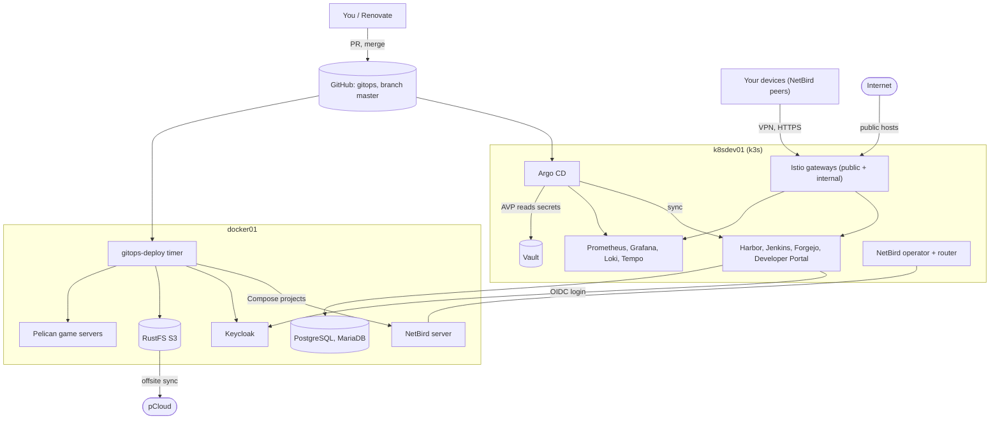
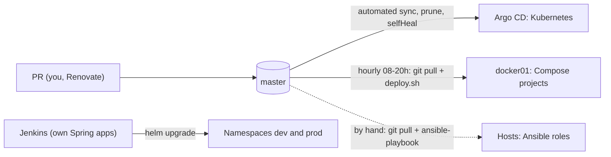
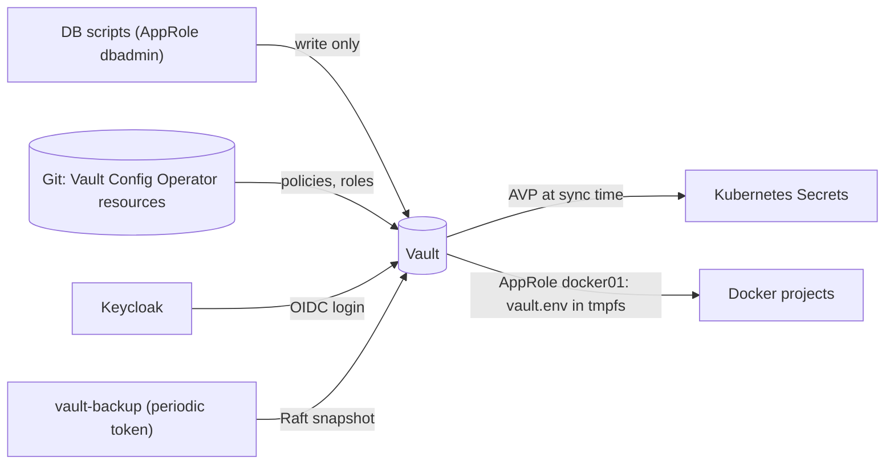
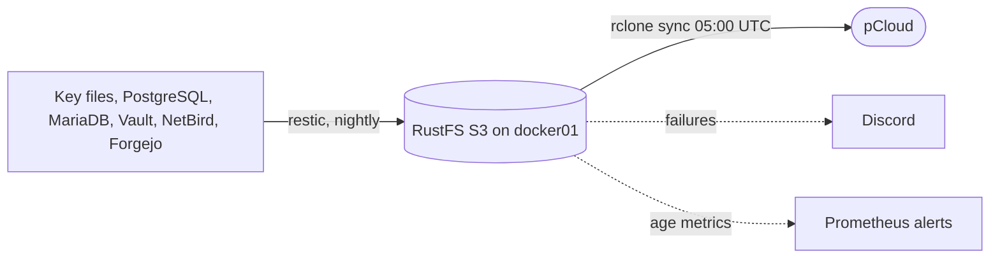

# GitOps

Infrastructure as code for two servers: a Docker host (`docker01`) and a k3s node (`k8sdev01`). Only **third-party apps**; own Spring apps are deployed by Jenkins (Helm), not from here.

> **A merge to `master` is a live deployment.** Prepare changes on a branch. Agent rules: [AGENTS.md](AGENTS.md).

## Contents

| Folder | Content | Docs |
|---|---|---|
| `kubernetes/` | Argo CD app-of-apps, one folder per domain | [kubernetes.md](docs/kubernetes.md) |
| `docker/` | one Compose project per service on `docker01` | [docker.md](docs/docker.md) |
| `ansible/` | host setup: base, firewall, Docker, NetBird client, k3s, databases, exporters, timers | [ansible.md](docs/ansible.md) |
| `databases/` | declared PostgreSQL access of `docker01` | [databases.md](docs/databases.md) |
| `scripts/` | `docker`, `postgresql`, `mariadb`, `netbird`, `vault`, `lib` | per topic |
| `istio/` | `IstioOperator` for the manual `istioctl install` (not synced by Argo CD) | [kubernetes.md](docs/kubernetes.md#istio-installation) |

## Architecture

| Host | Runs | Reached via |
|---|---|---|
| `k8sdev01` | k3s: Argo CD, Vault, Istio, Harbor, Jenkins, Forgejo, Developer Portal frame, Prometheus/Grafana, Loki/Alloy, Tempo | NetBird only (`https://<app>.k8sdev.rjst.de`); public hosts only through the public Istio gateway |
| `docker01` | Compose projects (NetBird server, Keycloak, RustFS, backups, Pelican, cAdvisor), PostgreSQL 18, MariaDB, Ansible-managed timers | NetBird only (SSH as `root`, repo at `/root/gitops`) |

## How a change goes live

| Target | Trigger | Rollback | Details |
|---|---|---|---|
| Kubernetes (`kubernetes/`) | merge to `master`, Argo CD syncs at once | `git revert` | [kubernetes.md](docs/kubernetes.md) |
| Docker (`docker/`) | `gitops-deploy.timer`, hourly 08:00-20:00 (NetBird project: by hand) | `git revert` | [docker.md](docs/docker.md) |
| Hosts (`ansible/`) | by hand: dry run (`--check --diff`), then apply, on explicit request | `git revert` + re-run | [ansible.md](docs/ansible.md) |
| Databases (`databases/`) | `postgresql-apply.timer`, hourly 08:30-20:30 (no `--prune`, MariaDB by hand) | `git revert` | [databases.md](docs/databases.md#declared-access) |
| Versions | Renovate PRs (3 days minimum age); some Docker digests auto-merge | `git revert` | [updates.md](docs/updates.md) |

## Secrets

Nothing secret in Git (not even base64). Everything lives in Vault.

| Where | Secrets | Docs |
|---|---|---|
| Vault `argocd/` | Kubernetes app secrets (rendered by the AVP plugin) | [vault.md](docs/vault.md) |
| Vault `docker/` | Docker project secrets, S3 keys | [docker.md](docs/docker.md#secrets-from-vault) |
| Vault `databases/` | DB passwords (hosts can write, not read) | [databases.md](docs/databases.md#passwords-in-vault) |
| Ansible | none; NetBird join is a manual step with a one-time key | [ansible.md](docs/ansible.md#netbird-client) |
| Password manager | restic passwords, pCloud `rclone.conf`, Vault unseal keys + root token | [backups.md](docs/backups.md#restore) |

## Backups

| Time (UTC) | Job |
|---|---|
| 02:00 | `forgejo-backup` (CronJob) |
| 02:30 | `vault-backup` |
| 03:00 | `restic-backup` (key files, SQL dumps, prune, checks) |
| 05:00 | offsite sync to pCloud + check |

Overview, retention, restore and per-service setup: [backups.md](docs/backups.md), [backup-services.md](docs/backup-services.md).

## Monitoring and access

| Topic | Tool | Docs |
|---|---|---|
| Metrics, dashboards | Prometheus, Grafana (Keycloak login), node/postgres/mysqld exporters | [ansible.md](docs/ansible.md#node-exporter-and-update-monitoring) |
| Alerts | Alertmanager to Discord (deploy, backup age, OS updates, DB, probes) | [backups.md](docs/backups.md#backup-age-alerts) |
| Logs / traces | Loki + Alloy, Tempo | [kubernetes.md](docs/kubernetes.md#logs-loki-alloy) |
| VPN, proxy, DNS | NetBird (config by hand in the dashboard) | [netbird.md](docs/netbird.md) |
| Login | Keycloak, realm `rjst` as code | [keycloak.md](docs/keycloak.md) |

## Docs

Metabase and balance pipeline commissioning: [docs/metabase.md](docs/metabase.md).

| Topic | File |
|---|---|
| Kubernetes, deployment guide, Istio, tracing, logs | [docs/kubernetes.md](docs/kubernetes.md) |
| Vault: init, secrets, operator, AppRoles, OIDC | [docs/vault.md](docs/vault.md) |
| Docker host: deploy, timer, secrets | [docs/docker.md](docs/docker.md) |
| Backups: overview, alerts, restore | [docs/backups.md](docs/backups.md) |
| Backup services: restic, dumps, RustFS, Pelican, Vault, NetBird | [docs/backup-services.md](docs/backup-services.md) |
| Ansible roles, firewall, k3s, timers | [docs/ansible.md](docs/ansible.md) |
| Databases: scripts, audit log, declared access | [docs/databases.md](docs/databases.md) |
| NetBird: server, CrowdSec, Kubernetes access | [docs/netbird.md](docs/netbird.md) |
| Keycloak and OIDC logins | [docs/keycloak.md](docs/keycloak.md) |
| Jenkins, Forgejo, Developer Portal | [docs/apps.md](docs/apps.md) |
| Renovate | [docs/updates.md](docs/updates.md) |

## Quick commands

| Task | Command |
|---|---|
| Ansible dry run | `cd ansible && ansible-playbook -i inventory.ini site.yml --check --diff` |
| Deploy a Docker project | `sudo scripts/docker/deploy.sh <project>` (`--list` shows all) |
| Deploy timer log | `journalctl -u gitops-deploy -n 100` |
| Backup now | `sudo scripts/docker/backup-now.sh [--background]` |
| Restore key files / dumps | `sudo scripts/docker/restore.sh snapshots docker` ([backups.md](docs/backups.md#restore)) |
| Declared DB access | `sudo scripts/postgresql/apply_declared.sh --dry-run` |
| DB apply timer log | `journalctl -u postgresql-apply -n 100` |
| Join NetBird (once) | `netbird up --setup-key <key> --management-url <url>` |
| Argo CD apps | `kubectl get applications -n argocd` |

## Rules

- Git is the source of truth; no `kubectl apply/edit/patch/delete` or `helm install/upgrade` against the cluster (fix drift in Git)
- Pin versions exactly; Renovate raises them
- Deleting a file deletes the resource (`prune`): take care with PVCs, namespaces, operators, CRDs, Vault
- No plaintext secrets in Git; found one: report it and rotate it
