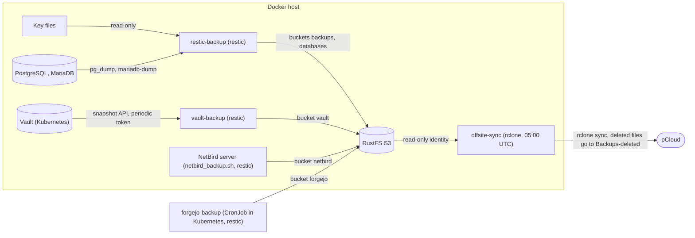

# Backups

All backups of the Docker host go to the local RustFS S3 first, then once a night to pCloud. Every service is its own Compose project (setup per service: [backup-services.md](backup-services.md)).

## Overview



| Service | Task | Notes |
|---|---|---|
| RustFS | local S3 staging | one identity per service (`docker/rustfs/identities.json`, keys in Vault); offsite sync is read-only |
| restic-backup | one nightly run: key files + SQL dumps of all PostgreSQL/MariaDB databases, forget, prune, check; also checks the Vault and NetBird repositories | repositories `backups/docker`, `databases/restic`; reports every step to Prometheus |
| vault-backup | daily Raft snapshot of Vault | periodic read-only token, repository `vault/raft`, own retention |
| NetBird backup | config + database of the NetBird server (`scripts/netbird/`) | repository `netbird/restic`, own retention, runs before each upgrade and by hand |
| forgejo-backup | CronJob: stops Forgejo, dump + data volume in one snapshot, starts it | repository `forgejo/restic`, see [apps.md](apps.md#forgejo) |
| Offsite sync | copies the whole S3 to pCloud and verifies | deleted/overwritten files stay 30 days in `Backups-deleted` |

- Everything writes to the S3 only; pCloud is written by the offsite sync alone
- **Not covered:** Kubernetes PVCs except Forgejo. Pelican Panel and Wings config (on purpose), etcd snapshots, Jenkins build history, Traces and Loki logs are also not covered
- MariaDB is only backed up once `MARIADB_PASSWORD` is in the Vault secret `docker/restic-backup`

## Retention, checks and schedule

| Data | Daily | Weekly | Monthly | Set in |
|---|---|---|---|---|
| Vault | 14 | 8 | 12 | `vault-backup` (`restic forget --prune` after each run) |
| SQL dumps | 14 | 8 | 6 | `restic-backup` (`DATABASES_KEEP_*`, per engine) |
| Key files | 7 | 4 | 6 | `restic-backup` (`KEEP_*`) |
| NetBird | 0 | 8 | 6 | `netbird_backup.sh` (`RESTIC_KEEP_*` in `/etc/netbird-backup.cred`) |
| Forgejo | 14 | 8 | 6 | `kubernetes/cicd/kubectl/forgejo-backup.yaml` (`KEEP_*`) |
| Deleted files in pCloud | 30 days | | | `RETENTION_DAYS` of the offsite sync |

| Check | How |
|---|---|
| Repository + data sample | `restic-backup` nightly on `docker`, `databases`, `vault`, `netbird` and `forgejo`: `restic check` with 10% read-data subset (`CHECK_READ_DATA_SUBSET`), whole repo read after ~10 nights |
| Offsite copy | `rclone check --one-way --size-only` S3 -> pCloud after each sync (no common hash); mismatch fails the sync |
| Failed jobs | Discord for offsite sync, `vault-backup`, `netbird_backup.sh`, optional `restic-backup` |
| Missing runs | Prometheus age alerts ([below](#backup-age-alerts)) |
| Restorable | by hand once per quarter, from **pCloud** |

| Time (UTC) | Job |
|---|---|
| 02:00 | forgejo-backup (Forgejo stopped 1-2 min) |
| 02:30 | vault-backup |
| 03:00 | restic-backup (key files, SQL dumps, forget, prune, checks of the repositories) |
| 05:00 | offsite sync + check (nothing writes to the S3 any more) |

## Discord alerts

Only failures are posted. A job that does not run at all sends nothing: look at `docker ps` now and then, and see [age alerts](#backup-age-alerts).

1. Create a channel only for alerts: **Edit Channel > Integrations > Webhooks > New Webhook**, copy the URL
2. The URL is a secret, keep it out of Git
3. Enter it where the job runs:

| Job | Where |
|---|---|
| `offsite-sync`, `vault-backup`, `restic-backup` | `DISCORD_WEBHOOK_URL` in Vault `docker/<project>` (`vault kv patch`), then `sudo scripts/docker/deploy.sh <project>` |
| `netbird_backup.sh` | `sudo ./netbird_backup_setup.sh --discord-webhook <url>` (writes `/etc/netbird-backup.cred`) |

4. Test, a message must appear:

```bash
curl -H 'Content-Type: application/json' -d '{"content":"test"}' '<webhook url>'
docker exec offsite-sync sh -c 'wget -q -O /dev/null --header "Content-Type: application/json" --post-data "{\"content\":\"offsite-sync test\"}" "$DISCORD_WEBHOOK_URL"'
```

- An old `PUSH_URL` in a Vault secret or `/etc/netbird-backup.cred` is ignored: delete the line
- Uptime Kuma is gone: `sudo scripts/docker/undeploy.sh uptimeKuma` (else `docker rm -f uptime-kuma`); data stays in `/root/docker/uptime-kuma` until deleted

## Backup age alerts

`offsite-sync`, `vault-backup`, `restic-backup` write `backup_last_success_timestamp_seconds{backup="<job>"}` to `/var/lib/prometheus/node-exporter/<job>.prom` after each success (`restic-backup`: only when every step worked). Rules in `kubernetes/monitoring/kubectl/alert-rules.yaml` fire when the last success is older than 26 h or a job never reported.

| Metric | Written by | Alert |
|---|---|---|
| `backup_last_success_timestamp_seconds{backup}` | the three jobs | older than 26 h / never reported |
| `restic_step_success{repository,step}`, `restic_step_last_success_timestamp_seconds`, `restic_step_duration_seconds` | `restic-backup`, per step (`backup`, `forget`, `prune`, `check` of `docker`; `backup-postgresql`, `backup-mariadb`, `forget`, `prune`, `check` of `databases`; `check` of `vault`, `netbird`) in `restic-backup-<repository>-<step>.prom` | `ResticStepFailed` |
| `restic_repository_size_bytes`, `restic_repository_snapshots`, `restic_repository_newest_snapshot_timestamp_seconds` (UTC) | last step `stats`, `restic-backup-<repository>-repository.prom` | none; Status dashboard tables/graph |

- Alerts go through Alertmanager to Discord (webhook in Vault `argocd/data/prometheus#discord_webhook_url`)
- `netbird_backup.sh` writes no metric (only its own Discord message; NetBird is backed up by hand with each update)
- Run log of `restic-backup`: `docker logs restic-backup`
- Check after first deploy: `curl -s localhost:9100/metrics | grep backup_last` on `docker01`

## Setup order

1. pCloud remote: on a machine with browser + rclone run `rclone authorize "pcloud"`, keep the token JSON (setup script asks for it and creates remote `pCloud` in `/root/.config/rclone/rclone.conf`; an existing remote is reused)
2. Discord webhook ([above](#discord-alerts))
3. Prepare the host (data directories, `rclone.conf`, pCloud check): `sudo scripts/docker/setup-backup-host.sh`
4. RustFS ([backup-services.md](backup-services.md#rustfs)): keys in Vault, deploy `rustfs`, `sudo scripts/docker/setup-rustfs.sh` (buckets `backups`, `databases`, `vault`, `pelican`, `netbird`, users, policies)
5. Secrets into Vault (`vault kv put docker/<project> ...`, admin token); `deploy.sh` lists what is missing:

| Secret | Keys |
|---|---|
| `docker/restic-backup` | `RESTIC_PASSWORD_DOCKER`, `RESTIC_PASSWORD_DATABASES` (new: `openssl rand -base64 24`, also into the password manager), `POSTGRES_PASSWORD`, optional `MARIADB_PASSWORD` ([dumps](backup-services.md#database-dumps)), `RESTIC_PASSWORD_VAULT`, `RESTIC_PASSWORD_NETBIRD` (= `RESTIC_PASSWORD` of `docker/vault-backup` = first line of `/root/restic`), optional `DISCORD_WEBHOOK_URL` |
| `docker/offsite-sync` | `DISCORD_WEBHOOK_URL` |
| `docker/vault-backup` | `VAULT_TOKEN`, `RESTIC_PASSWORD` (Vault repository), optional `DISCORD_WEBHOOK_URL` |

`VAULT_TOKEN` is a periodic token that may only read the Raft snapshot (policy `vault_snapshot`, `infra/kubectl/kube-vault-config.yaml`). Create it once with an admin token (shown once):

```bash
vault token create -policy=vault_snapshot -period=768h -orphan -field=token
vault kv patch docker/vault-backup VAULT_TOKEN=<token>
```

- `docker01` must reach `https://vault.k8sdev.rjst.de`: it is a NetBird peer in group `k8s-users` (policy `k8s-users` -> `kubernetes-services`, see [netbird.md](netbird.md#configuration-for-kubernetes))

6. Deploy: `sudo scripts/docker/deploy.sh restic-backup vault-backup offsite-sync`
7. Database backup logins ([dumps](backup-services.md#database-dumps)), test: `docker exec restic-backup sh /backup.sh now`
8. Restic passwords and `rclone.conf` into the password manager (without them pCloud backups are unreadable)

- Keycloak (`8180`) and the S3 port (`9000`) are published on all interfaces: restrict them to NetBird with a host firewall and NetBird policies
- Schedule backups between 01:00 and 03:00 so they finish before the sync

## Test the restore

A backup never restored is not a backup. After the first nightly sync, then quarterly, restore a volume or database from **pCloud**, not the local S3. Key files: `sudo scripts/docker/restore.sh --from pcloud restore docker`.

## Restore

**Keep in the password manager** (not on the servers, nothing is readable without them):

- restic passwords of `docker`, `databases` (project `restic-backup`), `vault` (project `vault-backup`), `netbird` (`/root/restic`)
- the pCloud `rclone.conf` (token)
- Vault unseal keys and root token (printed once by `vault operator init`)

| Data | Restore with |
|---|---|
| Key files (`rclone.conf`, `secret.key`; secrets are in Vault) | `scripts/docker/restore.sh`, repository `docker` |
| PostgreSQL, MariaDB | `scripts/docker/restore.sh`, repository `databases` |
| Vault | `scripts/vault/vault_restore.sh` |
| NetBird server | `netbird_restore.sh` |
| Forgejo | CronJob `forgejo-restore`, see [apps.md](apps.md#forgejo) |
| Pelican game servers | Pelican Panel, or unpack the `.tar.gz` by hand |
| Whole S3 lost | restic directly from pCloud |

`restore.sh` takes `docker`, `databases`, `vault`, `netbird`, `forgejo` (the last three can be browsed this way). Needs the running container `restic-backup`; with the S3 gone use `--from pcloud`.

### Key files

```bash
sudo scripts/docker/restore.sh snapshots docker
sudo scripts/docker/restore.sh files docker <snapshot>
sudo scripts/docker/restore.sh restore docker                       # default latest
sudo scripts/docker/restore.sh restore docker <snapshot> --include /userdata/docker/offsite-sync/rclone/rclone.conf
```

- Restores into a **new** folder `/root/docker/restic-backup/restore/<repository>-<snapshot>-<time>` (never overwrites); files hold secrets in plain text: delete afterwards
- Snapshot path `/userdata/docker` = host `/root/docker`, `/userdata/gitops` = `/root/gitops`
- Copy the file back (`/root/docker/offsite-sync/rclone/rclone.conf`), check owner/mode `600`, deploy the project with `deploy.sh`
- After a total RustFS loss: deploy it, run `setup-rustfs.sh` again (keys are in Vault), then fill it from pCloud ([below](#the-s3-is-lost))

### PostgreSQL and MariaDB

Dumps are plain SQL, one file per database, repository `databases`: `postgresql/<database>.sql` and `postgresql/globals.sql` (roles without passwords, tablespaces), tag `postgresql`; `mariadb/<database>.sql`, tag `mariadb`. Passwords are in Vault, not in the dumps.

```bash
sudo scripts/docker/restore.sh --tag postgresql snapshots databases
sudo scripts/docker/restore.sh --tag postgresql restore databases
sudo scripts/docker/restore.sh --tag postgresql restore databases <snapshot> --include /dump/postgresql/<database>.sql
```

On a new server:

1. Ansible role `postgresql` (PostgreSQL 18 with `pg_cron`, `pg_partman`)
2. Restore `globals.sql` for the roles (set passwords with `user_password.sh`, they live in Vault only), create the database with `db_create.sh <name>`, backup role with `backup_user_create.sh`
3. Load the dump (restore into a scratch database first; extensions `pg_cron`/`pg_partman` must exist; the shell reads the file because user `postgres` cannot enter `/root`):

```bash
sudo -u postgres psql --set ON_ERROR_STOP=on --dbname <database> < <folder>/dump/postgresql/<database>.sql
mariadb <database> < <folder>/dump/mariadb/<database>.sql
```

- Without the Docker host: same with `--from pcloud`, or `restic -r rclone:pCloud:/Backups/s3/databases/restic restore latest --tag postgresql --target <folder>` with the `databases` password

### Vault

1. Vault runs (Argo, `kube-vault.yaml`), initialised and unsealed ([vault.md](vault.md#initialize-fresh-vault-only))
2. Host with the `vault` CLI: `VAULT_ADDR`, `VAULT_TOKEN` (root token), and `/etc/vault-backup.cred` with `S3_ENDPOINT=...`, `AWS_ACCESS_KEY_ID=...`, `AWS_SECRET_ACCESS_KEY=...` (identity `vault` or `restic-backup`)
3. Put the Vault repository password into a file, run the script (lists snapshots, asks which):

```bash
sudo RESTIC_PASSWORD_FILE=/root/restic-vault scripts/vault/vault_restore.sh
```

- A snapshot replaces all Vault data; after restoring a snapshot of another cluster the unseal keys of the backed-up cluster apply and the restore may need `-force`
- Snapshots from before the move: `rclone:pCloud:/Backups/vault_pb` (set `RESTIC_REPOSITORY`)

### NetBird

`netbird_restore.sh` works on the original server and on a new one (Docker + Compose installed, same domain pointing to it, TCP 80/443 and UDP 3478 open). Needs `/etc/netbird-backup.cred` (S3 keys of identity `netbird`) and `/root/restic` (both written by `netbird_backup_setup.sh`).

```bash
sudo netbird_restore.sh
```

- After a failed upgrade: `netbird_rollback.sh` returns to the rollback point from `netbird_upgrade.sh`

### Pelican game servers

Panel -> server -> Backups -> Restore. Pelican fetches from bucket `pelican`; the Wings must reach port 9000. Panel and Wings config are not backed up on purpose ([backup-services.md](backup-services.md#pelican-s3-backups)). Without the Panel unpack the `.tar.gz` by hand.

### The S3 is lost

The offsite sync keeps a copy of each bucket in `pCloud:/Backups/s3/<bucket>/`. Restic repositories can be read from there directly (needs `rclone.conf` + restic password):

```bash
restic -r rclone:pCloud:/Backups/s3/backups/docker snapshots
restic -r rclone:pCloud:/Backups/s3/databases/restic restore latest --tag postgresql --target /restore/databases
restic -r rclone:pCloud:/Backups/s3/vault/raft restore latest --target /restore/vault
restic -r rclone:pCloud:/Backups/s3/netbird/restic restore latest --target /restore/netbird
```

- With `restic-backup` running: `sudo scripts/docker/restore.sh --from pcloud restore docker` (and `--tag postgresql restore databases`); reads the offsite sync's `rclone.conf`, needs no S3
- Refill a new RustFS: `rclone sync pCloud:/Backups/s3 RUSTFS:` (S3 remote `RUSTFS`, root key from Vault `docker/rustfs`)
