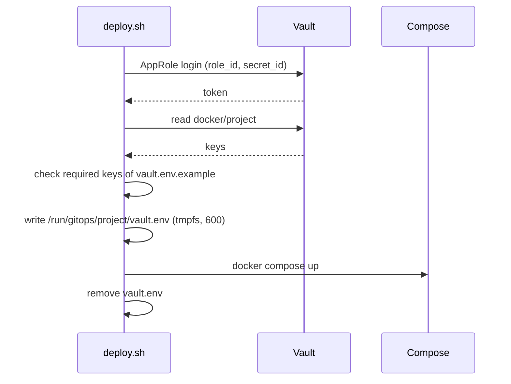

# Docker host

Compose projects in `docker/`, deployed by `scripts/docker/deploy.sh` on `docker01`. No management UI.

| Project | Purpose |
|---|---|
| `restic-backup`, `vault-backup`, `offsite-sync`, `rustfs` | backups, see [backups.md](backups.md) |
| `netbird` | self-hosted NetBird server, see [netbird.md](netbird.md) |
| `keycloak`, `keycloak-config` | login, see [keycloak.md](keycloak.md) |
| `pelicanPanel`, `pelicanWings` | game servers |
| `cadvisor` | container metrics |

- Images pinned by digest, updated by Renovate ([updates.md](updates.md))
- Per project: `default.env` (all variables, empty secrets), `vault.env.example` (keys from Vault; `NAME=` required, `#NAME=` optional)
- Projects with secrets: `rustfs`, `restic-backup`, `offsite-sync`, `vault-backup`, `keycloak`, `keycloak-config`, `netbird`

## Deploy

Idempotent: a project is only recreated when its compose file, image or environment changed.

```bash
sudo scripts/docker/deploy.sh                            # all projects, fixed order
sudo scripts/docker/deploy.sh restic-backup vault-backup # only these
sudo scripts/docker/deploy.sh --pull rustfs              # git pull --ff-only first
sudo scripts/docker/deploy.sh --list
```

| Script | Purpose |
|---|---|
| `deploy.sh` | deploy; never removes anything |
| `undeploy.sh <project>...` | remove containers and networks (data and volumes stay); asks first, `--yes` skips |
| `cleanup.sh [--apply]` | dry run lists unused Docker resources; `--apply` removes only untagged unused images and build cache |
| `restart-host-network.sh` | restart host-network containers after `apt upgrade` or a NetBird DNS change |
| `backup-now.sh [--background]` | all backups + offsite sync now (log: `/var/log/backup-now.log`) |
| `setup-backup-host.sh`, `setup-rustfs.sh`, `restore.sh` | see [backups.md](backups.md) |

- `cleanup.sh` only lists: tagged images without container, volumes (data), stopped containers, networks, `netbird-rollback/*`, Pelican's own networks
- `restart-host-network.sh`: host-network containers keep the `resolv.conf` copied at start, so they lose NetBird names (`vault-backup`: "Could not resolve host: vault.k8sdev.rjst.de")
- Containers mounting `/var/run/docker.sock` (`pelican_wings`): Docker runs with `live-restore`, so a `dockerd` restart leaves them on the old socket. Role `docker` adds a drop-in `docker.service.d/restart-socket-containers.conf` that restarts `docker_socket_containers` after each start
- Move from the old management UI (once): `git pull`, `setup-backup-host.sh`, secrets into Vault, then deploy project by project with `--adopt` (removes the same-named container of another Compose project; short interruption, data stays), finally remove the old UI container

## Automatic deploy

Timer `gitops-deploy.timer` (role `gitops_deploy`) runs `deploy.sh --pull --metrics-file ...` in `/root/gitops` every 3 hours 08:00-20:00 (`gitops_deploy_calendar`), not at night. Only projects whose compose file, image or Vault secret changed are recreated. **Rollback = `git revert` on `master`.**

```bash
sudo ansible-playbook -i inventory.ini site.yml --tags gitops_deploy --check --diff   # in /root/gitops/ansible
sudo ansible-playbook -i inventory.ini site.yml --tags gitops_deploy
systemctl list-timers gitops-deploy.timer
journalctl -u gitops-deploy -n 100
sudo systemctl stop gitops-deploy.timer     # pause, e.g. while editing /root/gitops by hand
```

| Topic | Detail |
|---|---|
| Preconditions | AppRole files `/etc/gitops/role_id`, `secret_id`; without `role_id` the run is skipped |
| Pull fails | no error, no alert: `deploy.sh` logs a warning and deploys the checkout as it is (`gitops_deploy_pull_success` is `0` until the next successful pull) |
| Vault unreachable | projects with secrets are not deployed (no fallback); `DockerDeployFailed` after 30 min |
| Metrics | `/var/lib/prometheus/node-exporter/gitops-deploy.prom`: `gitops_deploy_project_success{project}`, `gitops_deploy_pull_success`, `gitops_deploy_last_success_timestamp_seconds`, `gitops_deploy_last_run_timestamp_seconds`, `gitops_deploy_revision_info{revision}` |
| Alerts | `kubernetes/monitoring/kubectl/alert-rules.yaml` (`gitops-deploy`) via Alertmanager to Discord |
| First rollout | merge to `master`, `git pull` on the host, run the Ansible command; `DockerDeployNeverReported` waits 2 h |
| Manual run | `deploy.sh` without `--metrics-file` does not touch the metrics |
| Not covered | `netbird` is not deployed by the timer (SSH and Vault go through NetBird), see [netbird.md](netbird.md#server) |

## Secrets from Vault

Secrets live in Vault (KV `docker`, secret `docker/<project>`), never in repo or host files. There is no `override.env`.



| Topic | Detail |
|---|---|
| Login | AppRole `docker01` (policy `docker`, in `infra/kubectl/kube-vault-config.yaml`); files `/etc/gitops/role_id`, `secret_id` (600) |
| Setup | KV engine `docker` and the files: [vault.md](vault.md#approle-logins-of-the-hosts) |
| **No CIDR binding** | Vault sees a pod address (`10.42.x.x`), else "source address unauthorized by CIDR restrictions" |
| Compose | reads `default.env` and `vault.env` (later wins; `vault.env` optional only so `docker compose logs` works) |
| S3 keys | `restic-backup`, `offsite-sync`, `vault-backup` get theirs from `docker/s3/<identity>` (added by `deploy.sh`; `vault-backup` uses identity `vault`) |
| Needs | `curl`, `jq` on the host |
| Values | no single quote or control character (line break); `deploy.sh` refuses them |
| Vault down / secret missing | project not deployed, running containers untouched, no fallback |
| Deploy only with `deploy.sh` | a manual `docker compose up` has no `vault.env` and starts without secrets |

New or changed secret:

1. `vault kv patch docker/<project> NAME=value` with an admin token (`vault kv put` replaces the whole secret). A new variable in the example file is reported by `deploy.sh` after `git pull`
2. `sudo scripts/docker/deploy.sh <project>`: Compose sees the changed environment and recreates the container (data lives in host folders)

Example: `vault kv put docker/keycloak KC_DB_USERNAME=... KC_DB_PASSWORD=... KC_BOOTSTRAP_ADMIN_PASSWORD=...`, then `sudo scripts/docker/deploy.sh keycloak`.

- **Total Vault loss:** restore Vault first ([backups.md](backups.md#restore)), then deploy projects. Restic passwords of the Vault repository and the pCloud `rclone.conf` are in the password manager (pCloud backups need neither S3 nor Vault)
