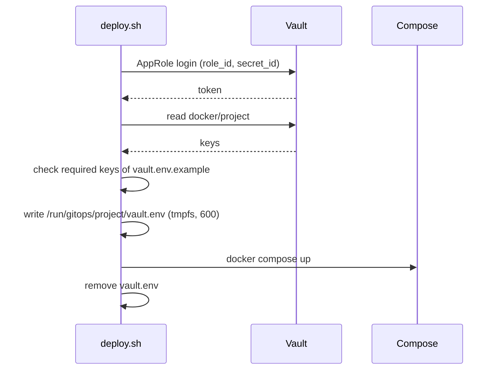

# Docker host

Compose projects in `docker/`, deployed by `scripts/docker/deploy.sh` on `docker01`.

| Project | Purpose |
|---|---|
| `restic-backup`, `offsite-sync`, `rustfs` | backups, see [backups.md](backups.md) |
| `netbird` | self-hosted NetBird server, see [netbird.md](netbird.md) |
| `keycloak`, `keycloak-config` | login, see [keycloak.md](keycloak.md) |
| `pelicanPanel`, `pelicanWings` | game servers |
| `arcane` | Docker web UI, see [Arcane](#arcane) |
| `cadvisor` | container metrics |
| `pokelit-bot` | game bot, see [Pokelit bot](#pokelit-bot) |

- Images pinned by digest, updated by Renovate ([updates.md](updates.md))
- Per project: `default.env` (all variables, empty secrets), `vault.env.example` (keys from Vault; `NAME=` required, `#NAME=` optional)
- Projects with secrets: `rustfs`, `restic-backup`, `offsite-sync`, `keycloak`, `keycloak-config`, `arcane`, `netbird`

## Network

- Projects with one container (`cadvisor`, `offsite-sync`, `restic-backup`, `rustfs`, `keycloak`, `keycloak-config`, `pokelit-bot`) share the network `shared` (`172.28.0.0/24`). `deploy.sh` creates it when it is missing; the compose files declare it `external`. Containers reach each other by container name (`keycloak-config` reaches `http://keycloak:8080`)
- Their access to the host (PostgreSQL, MariaDB, S3, Keycloak) goes through `host.docker.internal`, not through the network. The UFW rules allow `172.16.0.0/12`: a network outside of it (Docker takes `192.168.x` when `172.16.0.0/12` is used up) would lose that access
- `netbird` (fixed subnet `172.30.0.0/24`, Traefik `172.30.0.10`) and the networks of Pelican (`pelicanpanel_default`, `wings0`, `pelican_nw`) stay as they are
- After the first deploy the old networks (`cadvisor_default`, `offsite-sync_default`, `restic-backup_default`, `rustfs_default`, `keycloak`) are empty: `scripts/docker/cleanup.sh` lists them, remove by hand with `docker network rm <name>`

## Arcane

Arcane can inspect running containers and work with named Docker volumes through the Docker socket. Its own database lives in the `arcane_arcane_data` volume. Docker deployments continue through `deploy.sh`. The Git checkout is outside the Arcane container.

1. Before merging, run `scripts/vault/Generate-Secrets.ps1` ([vault.md](vault.md#secrets)): it creates `ARCANE_ENCRYPTION_KEY` and `ARCANE_OIDC_CLIENT_SECRET` in `docker/arcane` and `ARCANE_CLIENT_SECRET` (the same value as the OIDC client secret) in `docker/keycloak-config`.
2. From `/root/gitops` on `docker01`, run `sudo scripts/docker/deploy.sh keycloak-config` and check `docker logs keycloak-config` for a successful import. Arcane is part of `ALL_PROJECTS`: the deploy timer starts it within 3 hours of the merge, or run `sudo scripts/docker/deploy.sh arcane` at once. Without the two Vault secrets the timer fails on `arcane` (see `DockerDeployNeverReported`).
3. NetBird dashboard: reverse proxy service `arcane.proxy.rjst.de` to port `3552` of the Docker host, restricted to your peers, then open `https://arcane.proxy.rjst.de`. A container cannot reach `https://auth.proxy.rjst.de` (`403`), so Arcane calls Keycloak's token, userinfo and JWKS endpoints on `host.docker.internal:8180` (set in `default.env`, like RustFS in [backup-services.md](backup-services.md)); the browser uses the public authorization endpoint.
4. Roles come from Keycloak, like for the other apps: give a user the client role `admin` of the client `arcane` (Users > Role mapping). `ARCANE_OIDC_ROLE_MAPPINGS` in `docker/arcane/default.env` turns it into the Arcane role `role_admin` on every startup; these mappings are read-only in the Arcane UI. Admin means control of the Docker socket, so grant it only to people who may be root on `docker01`. For scoped roles (a project or volume) map further claim values under **System → Groups** in Arcane.
5. For the initial setup and recovery, sign in as `arcane` with the initial password from `/app/data/initial-admin-password` in the container and set a new password. Then test a Keycloak login with a user that has the role.

## Pokelit bot

Own Node.js app with a headed Chromium (not a Spring app, so not built by Jenkins). The source is **not** in this repository: the image is built on `docker01` from `/opt/pokelit-bot` (copy of `github.com/ToXiCCuss/pokelit-bot`), the compose file here only runs it. Not in `ALL_PROJECTS`: `up -d` never rebuilds, so the timer could not update the code.

- Login (`BOT_LOGIN_NAME`, `BOT_LOGIN_PASSWORD`) is in Vault `docker/pokelit-bot`; `BOT_REGION` is in `default.env`
- The project name has to stay `pokelit-bot`: the login profile lives in the volume `pokelit-bot_pokelit-profile`, and the image `pokelit-bot-pokelit-bot` keeps its name
- New code: copy the source to `/opt/pokelit-bot`, then `cd /root/gitops/docker/pokelit-bot && sudo docker compose -p pokelit-bot build`, then `sudo scripts/docker/deploy.sh pokelit-bot`. A change of the compose file or `default.env` needs only the deploy
- Logs: `/opt/pokelit-bot/logs`

## Deploy

Idempotent: a project is only recreated when its compose file, image or environment changed.

```bash
sudo scripts/docker/deploy.sh                            # all projects, fixed order
sudo scripts/docker/deploy.sh restic-backup offsite-sync # only these
sudo scripts/docker/deploy.sh --pull rustfs              # git pull --ff-only first
sudo scripts/docker/deploy.sh --list
```

| Script | Purpose |
|---|---|
| `deploy.sh` | deploy; never removes anything |
| `undeploy.sh <project>...` | remove containers and networks (data and volumes stay); asks first, `--yes` skips |
| `cleanup.sh [--apply]` | dry run lists unused Docker resources; `--apply` removes only untagged unused images and build cache |
| `backup-now.sh [--background]` | all backups + offsite sync now (log: `/var/log/backup-now.log`) |
| `setup-backup-host.sh`, `setup-rustfs.sh`, `restore.sh` | see [backups.md](backups.md) |

- `cleanup.sh` only lists: tagged images without container, volumes (data), stopped containers, networks, `netbird-rollback/*`, Pelican's own networks
- Containers mounting `/var/run/docker.sock` (`pelican_wings`): Docker runs with `live-restore`, so a `dockerd` restart leaves them on the old socket. Role `docker` adds a drop-in `docker.service.d/restart-socket-containers.conf` that restarts `docker_socket_containers` after each start
- Move from the old management UI (once): `git pull`, `setup-backup-host.sh`, secrets into Vault, then deploy project by project with `--adopt` (removes the same-named container of another Compose project; short interruption, data stays), finally remove the old UI container

## Automatic deploy

Timer `gitops-deploy.timer` (role `gitops_deploy`) runs `deploy.sh --pull --metrics-file ...` in `/root/gitops` every 3 hours 08:00-20:00 (`gitops_deploy_calendar`), not at night. Only projects whose compose file, image or Vault secret changed are recreated. **Rollback = `git revert` on `master`.**

```bash
sudo ansible-playbook -i inventory.ini site.yml --tags gitops_deploy --check --diff   # in /root/gitops/ansible
sudo ansible-playbook -i inventory.ini site.yml --tags gitops_deploy
systemctl list-timers gitops-deploy.timer
journalctl -u gitops-deploy -n 100
sudo systemctl stop gitops-deploy.timer     # pause, e.g. while editing /root/gitops by hand
```

| Topic | Detail |
|---|---|
| Preconditions | AppRole files `/etc/gitops/role_id`, `secret_id`; without `role_id` the run is skipped |
| Pull fails | no error, no alert: `deploy.sh` logs a warning and deploys the checkout as it is (`gitops_deploy_pull_success` is `0` until the next successful pull) |
| Vault unreachable | projects with secrets are not deployed (no fallback); `DockerDeployFailed` after 30 min |
| Metrics | `/var/lib/prometheus/node-exporter/gitops-deploy.prom`: `gitops_deploy_project_success{project}`, `gitops_deploy_pull_success`, `gitops_deploy_last_success_timestamp_seconds`, `gitops_deploy_last_run_timestamp_seconds`, `gitops_deploy_revision_info{revision}` |
| Alerts | `kubernetes/monitoring/kubectl/alert-rules.yaml` (`gitops-deploy`) via Alertmanager to Discord |
| First rollout | merge to `master`, `git pull` on the host, run the Ansible command; `DockerDeployNeverReported` waits 2 h |
| Manual run | `deploy.sh` without `--metrics-file` does not touch the metrics |
| Not covered | `netbird` is not deployed by the timer (SSH and Vault go through NetBird), see [netbird.md](netbird.md#server) |

## Secrets from Vault

Secrets live in Vault (KV `docker`, secret `docker/<project>`), never in repo or host files. There is no `override.env`.



| Topic | Detail |
|---|---|
| Login | AppRole `docker01` (policy `docker`, in `infra/kubectl/kube-vault-config.yaml`); files `/etc/gitops/role_id`, `secret_id` (600) |
| Setup | KV engine `docker` and the files: [vault.md](vault.md#approle-logins-of-the-hosts) |
| **No CIDR binding** | Vault sees a pod address (`10.42.x.x`), else "source address unauthorized by CIDR restrictions" |
| Compose | reads `default.env` and `vault.env` (later wins; `vault.env` optional only so `docker compose logs` works) |
| S3 keys | `restic-backup`, `offsite-sync` get theirs from `docker/s3/<identity>` (added by `deploy.sh`) |
| Needs | `curl`, `jq` on the host |
| Values | no single quote or control character (line break); `deploy.sh` refuses them |
| Vault down / secret missing | project not deployed, running containers untouched, no fallback |
| Deploy only with `deploy.sh` | a manual `docker compose up` has no `vault.env` and starts without secrets |

New or changed secret:

1. `vault kv patch docker/<project> NAME=value` with an admin token (`vault kv put` replaces the whole secret). A new variable in the example file is reported by `deploy.sh` after `git pull`
2. `sudo scripts/docker/deploy.sh <project>`: Compose sees the changed environment and recreates the container (data lives in host folders)

Example: `vault kv put docker/keycloak KC_DB_USERNAME=... KC_DB_PASSWORD=... KC_BOOTSTRAP_ADMIN_PASSWORD=...`, then `sudo scripts/docker/deploy.sh keycloak`.

- **Total Vault loss:** restore Vault first ([backups.md](backups.md#restore)), then deploy projects. Restic passwords of the Vault repository and the pCloud `rclone.conf` are in the password manager (pCloud backups need neither S3 nor Vault)
