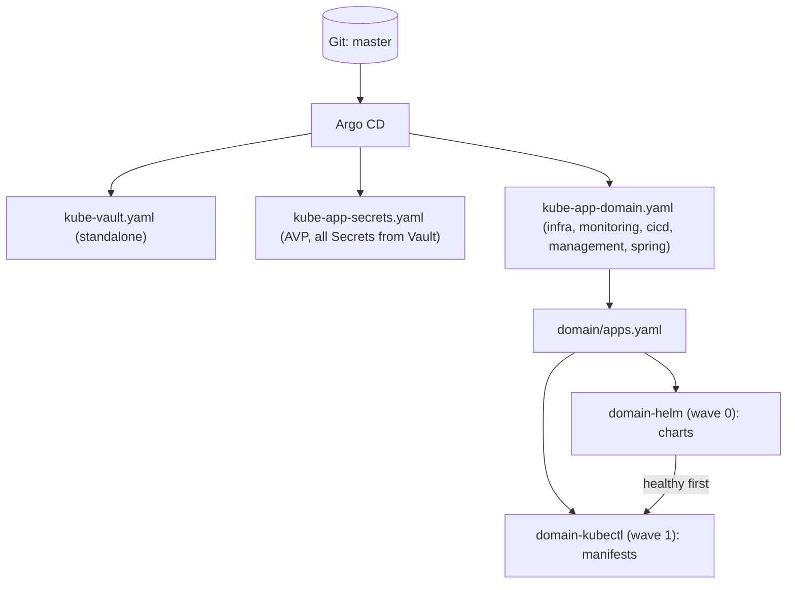
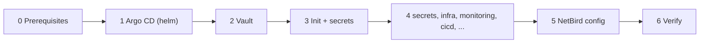

# Kubernetes

Argo CD app-of-apps on k3s (`k8sdev01`). **A merge to `master` is a live deployment** (`automated`, `prune`, `selfHeal`, `targetRevision: master`). Never `kubectl apply/edit/patch/delete` against the cluster; fix drift in Git.

## Structure

Each top-level app is an independently deployable domain (`kubernetes/kube-app-<name>.yaml`); inside, manifests are split by how they are deployed:

```
kubernetes/<domain>/
  apps.yaml     the two child Applications (the root app only reads this file)
  helm/         Applications wrapping Helm charts - sync wave 0
  kubectl/      raw manifests (custom resources, gateways, RBAC) - sync wave 1
```



| Domain | Content |
|---|---|
| (top level) | `kube-vault.yaml` (Vault), `kube-app-secrets.yaml` (every raw Secret that AVP fills from Vault), `argocd-values.yaml` (Argo CD itself, helm by hand) |
| `infra` | cert-manager, ClusterIssuer, Hetzner webhook, Istio internal gateway + security policies + telemetry, NetBird operator/router/access/API proxy, CoreDNS custom, Vault Config Operator, vault-unsealer |
| `monitoring` | Prometheus/Grafana, Alloy, Loki, Tempo, blackbox exporter, alert rules, dashboards, probes |
| `cicd` | Harbor, Jenkins, Forgejo (+ backup), `helm-deployer` role |
| `management` | Metabase (pending bootstrap), frame of the Developer Portal |
| `spring` | namespaces `dev`, `prod`, `helm-deployer` role (Spring apps themselves are deployed by Jenkins) |

Rules:

- `<domain>-kubectl` waits for `<domain>-helm` (operators and CRDs exist before the custom resources). Both are plain directory sources without AVP; `<path:...>` values in a Helm app are resolved by each child Application's AVP Helm plugin
- A Helm app must not depend on anything in the same domain's `kubectl/` (it runs first); a domain without Helm apps (`spring`) has no `helm/`
- Sync waves (annotation `argocd.argoproj.io/sync-wave`) order resources within `helm/` and within `kubectl/`, not across domains: `infra` must be healthy before the others (ClusterIssuer, cert-manager)
- Istio and Argo CD's own installation stay outside GitOps on purpose (too much blast radius)
- Secrets: **every** Secret filled from Vault lives in `secrets/`, the only place running the AVP plugin. Never put the plugin on a `helm/` app (it would write resolved passwords in plain text into the Application objects) or on an app whose files have no `<path` / `avp.kubernetes.io` marker (fails with "could not find cmp-server plugin")
- `kubernetes/archive/` and `kubernetes/parked/` no longer exist

## Public ingress gateway

The public `istio-ingressgateway` (installed by hand, see [Istio installation](#istio-installation)) is the only way into the cluster from the Internet. Everything else stays on the internal gateway. The former public status page (Gatus at `status.rjst.de`) is gone.

- **Public apps** set `istio.public: true` in their values (`kubernetes-values`, chart `spring-boot`) and are served at `<name>-<stage>.cloud.rjst.de` (stage = namespace, e.g. `shop-prod.cloud.rjst.de`; a public host in `urls` replaces this automatic host, it must be one of the hosts of the Gateway below). The chart creates only a VirtualService bound to `istio-system/public`; the Gateway `public` and its certificate (`rjst.de`, `www.rjst.de`, `*.cloud.rjst.de`, secret `public-tls`) live in `infra/kubectl/kube-istio-public.yaml`. A new public app needs no change in this repository, no DNS record and no `internalPort`. A wildcard covers one label: `shop-prod.cloud.rjst.de`, not `shop.prod.cloud.rjst.de`
- `AuthorizationPolicy` `ingress-policy-public` (`infra/kubectl/kube-istio-security.yaml`) allows only `rjst.de`, `www.rjst.de` and `*.cloud.rjst.de` and denies every other host: a public host outside these needs an entry there (and, without `istio.public`, its own Gateway and Certificate from the chart, the previous behavior)
- **`rjst.de` and `www.rjst.de`** are in the shared Gateway for the move of the app `rjst-frontend`. As long as its release has its own Gateway and Certificate (values without `istio.public`), these two hosts are defined twice: move the app in the same step (set `istio.public: true` in `prod/rjst-frontend.yaml`, deploy prod), then check `istioctl analyze` and `curl -I https://rjst.de`. When no app uses its own Certificate any more, drop the Role for `certificates` in `istio-system` from `cicd/kubectl/helm-deployer.yaml`
- Ports 80/443 are open on `k8sdev01` (`host_config.k8sdev01.firewall_rules`). Whether UFW passes ServiceLB ports depends on the FORWARD chain: check from outside with `curl -I https://<host>`
- DNS records are set by hand at Hetzner (A, public IP of `k8sdev01`): once the wildcard `*.cloud.rjst.de`, plus `rjst.de` and `www.rjst.de`. After an IP change update them, see [ansible.md](ansible.md#change-the-public-ip)

## Deployment guide

Order for a fresh cluster:



### 0. Prerequisites (once, outside GitOps)

1. Cluster reachable, `kubectl`/`helm` configured (k3s: [ansible.md](ansible.md#k3s))
2. Istio via `istioctl` ([below](#istio-installation)); still needed for the public apps
3. NetBird self-hosted server running ([quickstart](https://docs.netbird.io/selfhosted/selfhosted-quickstart)) at `proxy.rjst.de` with its own Traefik ([netbird.md](netbird.md))
4. NetBird personal access token (Management API scope) for the operator

### Istio installation

By hand from `istio/istio-operator.yaml` (profile `default`: istiod + public `istio-ingressgateway`). The file keeps what a plain install would reset: `externalTrafficPolicy: Local` on the gateway Service (apps see the real client address). Use an `istioctl` matching the wanted version (file does not pin it; `istioctl version`).

```bash
istioctl x precheck
istioctl install -f istio/istio-operator.yaml
istioctl verify-install -f istio/istio-operator.yaml
```

- Upgrade: new `istioctl`, same commands, then restart workloads in namespaces labelled `istio-injection: enabled`
- Check: `kubectl -n istio-system get svc istio-ingressgateway -o jsonpath='{.spec.externalTrafficPolicy}'` must print `Local`
- The internal gateway (`istio-internal-gateway`) is an Argo CD Application in `kubernetes/infra/helm`, not part of this file
- Not tracked by Renovate (version is passed to the scripts)

#### Distributed tracing (Tempo)

Sidecars and gateways send spans as OTLP/gRPC to Tempo (`monitoring/helm/tempo.yaml`, namespace `tempo`, ClusterIP only).

- `meshConfig.extensionProviders` in `istio/istio-operator.yaml` defines provider `tempo`: run `istioctl install` **before** the `Telemetry` resource (`infra/kubectl/kube-istio-telemetry.yaml`) syncs, else istiod rejects the unknown provider. Restart workloads in `istio-injection: enabled` namespaces afterwards
- `Telemetry` samples 100% mesh-wide (low traffic); lower `randomSamplingPercentage` if Tempo grows, or override per namespace
- Apps must pass trace headers on (Spring Boot: Micrometer Tracing with OpenTelemetry bridge, W3C `traceparent`), else every hop is its own trace. Put `traceId` into the log pattern
- Tempo derives RED metrics and service graph and writes them to Prometheus (`prometheusSpec.enableRemoteWriteReceiver`); Grafana reads via datasource `Tempo` (Explore -> Tempo -> Service Graph). Traces kept 48 h, not backed up

#### Logs (Loki, Alloy)

| Part | Detail |
|---|---|
| Loki | `monitoring/helm/loki.yaml`, namespace `loki`, one pod, filesystem storage, 7 days, no backup, cluster-internal only (`loki.loki:3100`, no gateway entry) |
| Alloy | `monitoring/helm/alloy.yaml`, namespace `alloy`, reads logs of all pods via the Kubernetes API, pushes to Loki |
| Labels | only `namespace`, `pod`, `container`, `app`; ids like `traceId` are never labels: `{app="freewar-chaos-service"} \|= "<id>"` |
| Datasources | `Loki` and `Tempo` from ConfigMap `monitoring/kubectl/loki.yaml`; trace id in a log line opens the trace (expects `[app,traceId,spanId]` or ECS `trace.id`) and back |
| Not collected | logs of `docker01` |

### 1. Bootstrap Argo CD

```bash
helm repo add argo https://argoproj.github.io/argo-helm
helm install argocd argo/argo-cd -n argocd --values argocd-values.yaml --create-namespace

# later, to apply changes to argocd-values.yaml:
helm upgrade argocd argo/argo-cd -n argocd --values argocd-values.yaml
```

Argo CD is not part of GitOps: a change of `argocd-values.yaml` only takes effect with `helm upgrade` (controller restarts briefly, Applications keep running).

### 2. Deploy Vault standalone

```bash
kubectl apply -f kubernetes/kube-vault.yaml
```

Not part of a domain: everything using AVP depends on Vault being up, unsealed and populated.

### 3. Initialize Vault and populate secrets

All of it is in [vault.md](vault.md): initialize and unseal, KV engines, Kubernetes auth (role `argocd` first), generated and typed secrets, Vault Config Operator, AppRole logins, Keycloak login. Do this **before** applying the `secrets` app.

### 4. Deploy the secrets, then the domains

```bash
kubectl apply -f kubernetes/kube-app-secrets.yaml     # 0. renders the Secrets from Vault via AVP, must be healthy before infra
kubectl apply -f kubernetes/kube-app-infra.yaml       # 1. cert-manager, ClusterIssuer, NetBird operator
kubectl apply -f kubernetes/kube-app-monitoring.yaml  # 2.
kubectl apply -f kubernetes/kube-app-cicd.yaml        # 3. onwards: order doesn't matter, all only need infra
kubectl apply -f kubernetes/kube-app-management.yaml
kubectl apply -f kubernetes/kube-app-spring.yaml
```

- Why `secrets` is its own app and comes first: some Helm apps need their Secret at start (the NetBird operator needs `netbird-mgmt-api-key`), but `helm/` runs before `kubectl/`
- Watch `infra` reach Healthy before applying the rest: nothing works without its ClusterIssuer and cert-manager

### 5. NetBird configuration

Groups in Git, zone, policies, CNAMEs by hand: [netbird.md](netbird.md#configuration-for-kubernetes). Per-app URLs and ports: [netbird.md](netbird.md#internal-apps).

### 6. Verify

```bash
kubectl get applications -n argocd
kubectl get clusterissuer
kubectl get certificates -A
kubectl get networkresources -A
```

All `Application` rows `Synced`/`Healthy`; each `NetworkResource` has an entry in the NetBird dashboard under zone `k8sdev.rjst.de`.

App-specific setup (Jenkins, Forgejo, Developer Portal): [apps.md](apps.md).
