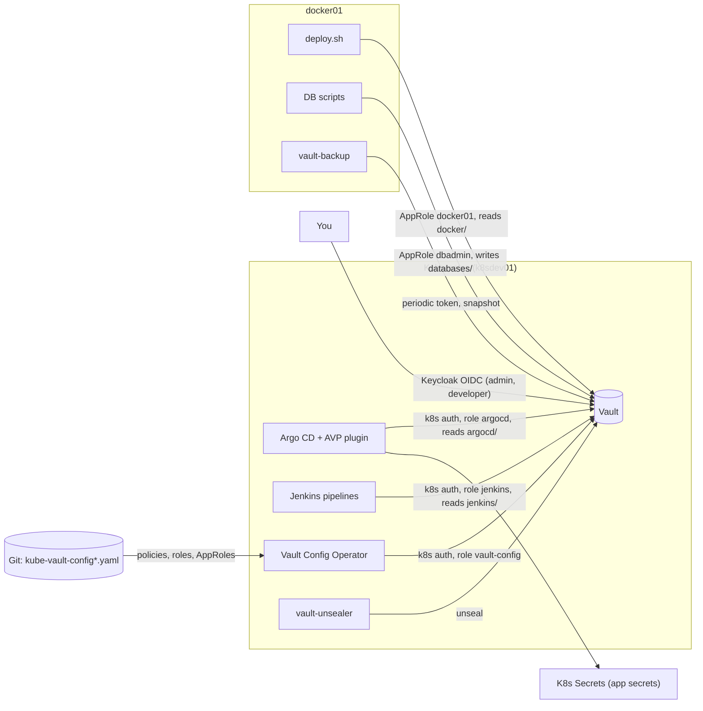

# Vault

Vault runs in the cluster (`kubernetes/kube-vault.yaml`, deployed standalone before anything else). All runtime secrets live here; nothing secret is in Git.



| Engine | Content | Reader |
|---|---|---|
| `argocd` | secrets of the Kubernetes apps (`argocd/data/<app>`) | Argo CD AVP plugin |
| `jenkins`, `dev`, `prod` | pipeline and Spring app secrets | Jenkins, Spring apps |
| `docker` | secrets of Docker projects (`docker/<project>`) and S3 keys (`docker/s3/<identity>`) | `deploy.sh` (AppRole `docker01`) |
| `databases` | DB passwords (`databases/<dbms>/<user>`) | write-only for the host (AppRole `dbadmin`) |

The AVP plugin (`avp-helm`/`avp`) reads at sync time: a missing path makes that Application fail to render, so populate Vault **before** the `secrets` app is applied. No script is needed, only the `vault` CLI and `kubectl`. On a fresh setup reach Vault by port-forward (`kubectl port-forward -n vault svc/vault 8200:8200`, `export VAULT_ADDR=http://127.0.0.1:8200`); later `https://vault.k8sdev.rjst.de` works over NetBird.

## Initialize (fresh Vault only)

```bash
vault operator init -key-shares=5 -key-threshold=3
```

- Prints five unseal keys and the root token **once**: copy into the password manager
- Unseal with three keys (`vault operator unseal` three times). The unsealer needs all five; they cannot come from Vault itself (circular on first install), so the Secret `vault-unsealer-config` is applied straight into the cluster. Keys are typed without echo:

```bash
{
  printf 'apiVersion: v1\nkind: Secret\nmetadata:\n  name: vault-unsealer-config\n  namespace: vault\n  labels:\n    vault-unsealer.bakito.net/stateful-set: vault\ntype: Opaque\nstringData:\n'
  for i in 1 2 3 4 5; do read -rsp "Unseal key $i: " key </dev/tty; echo >&2; printf '  unsealKey%s: "%s"\n' "$i" "$key"; done
} | kubectl apply -f -
```

Then `vault login` with the root token.

## KV engines and Kubernetes auth

```bash
for engine in argocd jenkins dev prod; do vault secrets enable -path=$engine -version=2 kv; done
```

`docker`, `databases` and the AppRole method: [AppRole logins](#approle-logins-of-the-hosts). Kubernetes auth lets workloads log in with their ServiceAccount:

```bash
kubectl -n vault create serviceaccount vault-auth
kubectl create clusterrolebinding vault-auth-delegator --clusterrole=system:auth-delegator --serviceaccount=vault:vault-auth
vault auth enable kubernetes
vault write auth/kubernetes/config \
  token_reviewer_jwt="$(kubectl -n vault create token vault-auth --duration=87600h)" \
  kubernetes_host=https://kubernetes.default.svc:443 \
  kubernetes_ca_cert="$(kubectl config view --raw --minify -o jsonpath='{.clusters[0].cluster.certificate-authority-data}' | base64 -d)" \
  disable_local_ca_jwt=true
```

- Vault reaches the API server via `https://kubernetes.default.svc:443`, not your kubeconfig address, so a new server IP does not break the login

**Role `argocd` is critical:** Argo CD's AVP plugin logs in through it (`AVP_AUTH_TYPE=k8s`), so nothing using AVP renders without it, **including the Vault Config Operator** that would otherwise create it. On a fresh Vault create this one policy and role by hand (the operator takes them over with the same values):

```bash
vault policy write argocd - <<'EOF'
path "argocd/data/*" {
  capabilities = ["read"]
}
EOF
vault write auth/kubernetes/role/argocd bound_service_account_names=argocd-repo-server bound_service_account_namespaces=argocd policies=argocd ttl=24h audience=https://kubernetes.default.svc.cluster.local
```

- Jenkins reads `jenkins/data/jenkins` in every pipeline: `cicd-library` logs in via role `jenkins` with the pipeline pod's token. The role accepts ServiceAccounts `default` and `helm-deployer` (`cicd/kubectl/helm-deployer.yaml`; helm needs no kubeconfig)
- Spring apps do not read Vault at runtime yet (Vault Agent / Spring Cloud Vault is a later step, app by app)

## Secrets

Generated values are 32 or 64 alphanumeric characters. Helpers (define once per shell):

| Helper | Does |
|---|---|
| `gen` | random alphanumeric string |
| `kv_set` | changes single keys, keeps others, creates the secret if missing (`vault kv patch` alone fails on a missing secret; `-cas=0` never overwrites) |
| `put_new` | creates a key only when missing, so the block can be re-run |

The generated keys are listed once in `scripts/vault/generated-secrets.txt` (`<secret> <key> <length>`); a new app adds its lines there. **Never replace `security.secret_key` of Forgejo** (it encrypts the database; `put_new` does not).

```bash
gen() { openssl rand -base64 300 | tr -dc "${2:-A-Za-z0-9}" | head -c "${1:-32}"; }
kv_set() { vault kv patch -method=rw "$@" 2>/dev/null || vault kv put -cas=0 "$@"; }
put_new() { vault kv get -mount=argocd -field="$2" "$1" >/dev/null 2>&1 || kv_set -mount=argocd "$1" "$2=$(gen "${3:-32}")"; }
grep -vE '^(#|$)' scripts/vault/generated-secrets.txt | while read -r secret key length; do put_new "$secret" "$key" "$length"; done
```

S3 keys of the RustFS identities: `sudo scripts/docker/setup-rustfs.sh` generates missing keys itself (an existing key is never changed) and copies the keys of an identity with `vaultCopy` into the secret of its app (e.g. `dev/er-launcher-service`), see [backup-services.md](backup-services.md#rustfs). By hand, on the Docker host or anywhere with the checkout and `jq`:

```bash
for name in $(jq -r '.identities[].name' docker/rustfs/identities.json); do
  vault kv get -mount=docker -field=access_key "s3/$name" >/dev/null 2>&1 && continue
  vault kv put -mount=docker -cas=0 "s3/$name" "access_key=$(gen 20 A-Z0-9)" "secret_key=$(gen 40)"
done
```

Forgejo backups need their S3 keys in the cluster; `restic-backup` needs the restic password of Forgejo for integrity checks. The AVP plugin may only read `argocd/` and the Docker host only `docker/`, so the values are copied (re-run after a change):

```bash
for app in forgejo; do
  kv_set -mount=argocd "$app" "backup.s3_access_key=$(vault kv get -mount=docker -field=access_key s3/$app)" "backup.s3_secret_key=$(vault kv get -mount=docker -field=secret_key s3/$app)"
done
kv_set -mount=docker restic-backup "RESTIC_PASSWORD_FORGEJO=$(vault kv get -mount=argocd -field=backup.restic_password forgejo)"
```

Values that must match reality are typed, never generated (`read -s` keeps them out of history and process list):

```bash
read -rsp 'Hetzner Cloud API token (DNS read/write): ' token; echo; kv_set -mount=argocd hetzner token="$token"
read -rsp 'NetBird Management API token: ' token; echo; kv_set -mount=argocd netbird api_key="$token"
```

Database logins come from the scripts on `docker01` (`db_create.sh <name>` first, it stores the owner's password in `databases/...`):

```bash
kv_set -mount=argocd forgejo database.username=forgejo_owner "database.password=$(vault kv get -mount=databases -field=password postgresql/forgejo_owner)"
kv_set -mount=argocd developer-portal database.username=developer_portal_owner "database.password=$(vault kv get -mount=databases -field=password postgresql/developer_portal_owner)"
kv_set -mount=argocd harbor database.username=<owner> "database.password=$(vault kv get -mount=databases -field=password postgresql/<owner>)"
```

| Vault path | Keys |
|---|---|
| `argocd/data/hetzner` | `token` (Hetzner Cloud API token, DNS read/write) |
| `argocd/data/netbird` | `api_key` (NetBird Management API token) |
| `argocd/data/prometheus` | `password` (Grafana admin), `oidc.client_secret` (Keycloak client `grafana`), `discord_webhook_url` (Alertmanager, see [backups.md](backups.md#backup-age-alerts)) |
| `argocd/data/harbor` | `admin.password`, `database.username`, `database.password` |
| `argocd/data/jenkins` | `password` (admin), `github_app_private_key` (PKCS#8 PEM of the GitHub App) |
| `argocd/data/argocd` | `oidc.client_secret` (client `argocd`) |
| `argocd/data/vault` | `oidc.client_secret` (client `vault`) |
| `argocd/data/forgejo` | `admin.password`, `oidc.client_secret`, `security.secret_key`, `security.internal_token`, `database.*`, `backup.*` |
| `argocd/data/developer-portal` | `oidc.client_secret`, `backend.secret`, `database.*` |

## Vault Config Operator

The [vault-config-operator](https://github.com/redhat-cop/vault-config-operator) writes Vault configuration from resources in Git: `infra/helm/vault-config-operator.yaml` installs it, resources are in `infra/kubectl/kube-vault-config.yaml`. **Removing a resource from the file removes it in Vault.**

| In Git (operator) | By hand |
|---|---|
| policies + roles `argocd`, `jenkins`, `spring_dev`, `spring_prod`; AppRoles `docker01`, `dbadmin` with policies; policy `vault_snapshot`; Keycloak login (`kube-vault-config-oidc.yaml`) | KV engines and auth methods (removing one would delete everything below), the kubernetes auth config, on a fresh Vault policy + role `argocd`, `secret_id`s, tokens, every secret value |

Every resource names ServiceAccount `vault/vault-config` and Vault role `vault-config`. Create the role once, **before the first sync**, with an admin token inside the Vault pod (`kubectl -n vault exec -it vault-0 -- sh`, then `vault login`). The policy is as powerful as an admin (the operator may create policies):

```bash
vault policy write vault-config - <<'EOF'
path "sys/policies/acl" { capabilities = ["list"] }
path "sys/policies/acl/*" { capabilities = ["create", "read", "update", "delete", "list"] }
path "sys/mounts" { capabilities = ["read", "list"] }
path "sys/mounts/*" { capabilities = ["create", "read", "update", "delete", "list", "sudo"] }
path "sys/auth" { capabilities = ["read", "list"] }
path "sys/auth/*" { capabilities = ["create", "read", "update", "delete", "list", "sudo"] }
path "auth/+/config" { capabilities = ["create", "read", "update"] }
path "auth/+/role/*" { capabilities = ["create", "read", "update", "delete", "list"] }
path "identity/*" { capabilities = ["create", "read", "update", "delete", "list"] }
EOF
vault write auth/kubernetes/role/vault-config bound_service_account_names=vault-config bound_service_account_namespaces=vault policies=vault-config ttl=1h
```

## AppRole logins of the hosts

`docker01` logs in with AppRole `docker01` (reads `docker/data/*`, creates `docker/data/s3/*` and merges the S3 keys into the secrets named in `identities.json`; used by `deploy.sh` and `setup-rustfs.sh`), the DB scripts with `dbadmin` (writes `databases/data/*`). Policies and roles are in Git. By hand with an admin token (inside the Vault pod or any machine reaching Vault):

```bash
vault secrets enable -path=docker -version=2 kv
vault secrets enable -path=databases -version=2 kv
vault auth enable approle
```

Then on the Docker host as root. Roles: `docker01` (files `role_id`, `secret_id`) and `dbadmin` (files `databases_role_id`, `databases_secret_id`). The token is read without echo, files get mode 600, a new `secret_id` is created and older ones are destroyed afterwards:

```bash
read -rsp 'Vault token: ' VAULT_TOKEN; echo
export VAULT_ADDR=https://vault.k8sdev.rjst.de
api() { printf 'X-Vault-Token: %s' "$VAULT_TOKEN" | curl -fsS -H @- "$@"; }
role=docker01; prefix=            # for dbadmin: role=dbadmin; prefix=databases_
base="$VAULT_ADDR/v1/auth/approle/role/$role"
install -d -m 700 /etc/gitops
api "$base/role-id" | jq -r .data.role_id | (umask 077; cat > "/etc/gitops/${prefix}role_id")
response=$(api -X POST "$base/secret-id")
jq -r .data.secret_id <<<"$response" | (umask 077; cat > "/etc/gitops/${prefix}secret_id")
keep=$(jq -r .data.secret_id_accessor <<<"$response")
for accessor in $(api "$base/secret-id?list=true" | jq -r '.data.keys[]'); do
  [ "$accessor" = "$keep" ] || api -X POST -d "{\"secret_id_accessor\":\"$accessor\"}" "$base/secret-id-accessor/destroy"
done
```

- If the old file is still in use, run the destroy loop only after the new one works (`sudo scripts/docker/deploy.sh --list` logs in); without the loop both `secret_id`s stay valid
- **Do not bind roles to an address** (`token_bound_cidrs`): Vault sees a pod address

## Login with Keycloak (OIDC)

Besides root token and Kubernetes login, Vault accepts a Keycloak login. Roles of client `vault` (`docker/keycloak-config/realms/rjst.yaml`) are external groups with one policy each:

| Keycloak role | Policy | Rights |
|---|---|---|
| `admin` | `keycloak_admin` | everything |
| `developer` | `keycloak_developer` | read/write secrets in `dev/` and `prod/`, no delete |

A user without one of the roles is refused. Config in Git (`infra/kubectl/kube-vault-config-oidc.yaml`): client, role, policies, groups. **Not in Git:** the auth method and group aliases (removing the method would delete the login; an alias cannot be taken over once it exists). On a fresh Vault create them once with an admin token, the aliases only after the first sync (they need the groups):

```bash
vault auth enable -path=oidc oidc
for group in admin developer; do
  vault write identity/group-alias name=$group mount_accessor=$(vault read -field=accessor sys/auth/oidc) canonical_id=$(vault read -field=id identity/group/name/$group)
done
```

- Client secret `argocd/data/vault#oidc.client_secret` is generated; copy it into Vault `docker/keycloak-config` as `VAULT_CLIENT_SECRET`, then `sudo scripts/docker/deploy.sh keycloak-config`
- Argo CD renders the secret as `vault/vault-oidc` (`kubernetes/secrets/vault-oidc.yaml`); the operator reads it there and needs no right on `argocd/data/vault`
- UI: method **OIDC**, type `default` into **Role** (empty gives "Invalid role"), or `vault login -method=oidc`. Give users the role `vault` in Keycloak (client roles)
- Vault reads Keycloak's discovery when the config is written and the pod needs `auth.proxy.rjst.de` at login: on failure check cluster DNS first

## Backups

Vault is backed up from the Docker host, not Kubernetes: periodic token with policy `vault_snapshot`, independent of the cluster. See [backup-services.md](backup-services.md#vault-backup) and [backups.md](backups.md#vault).
